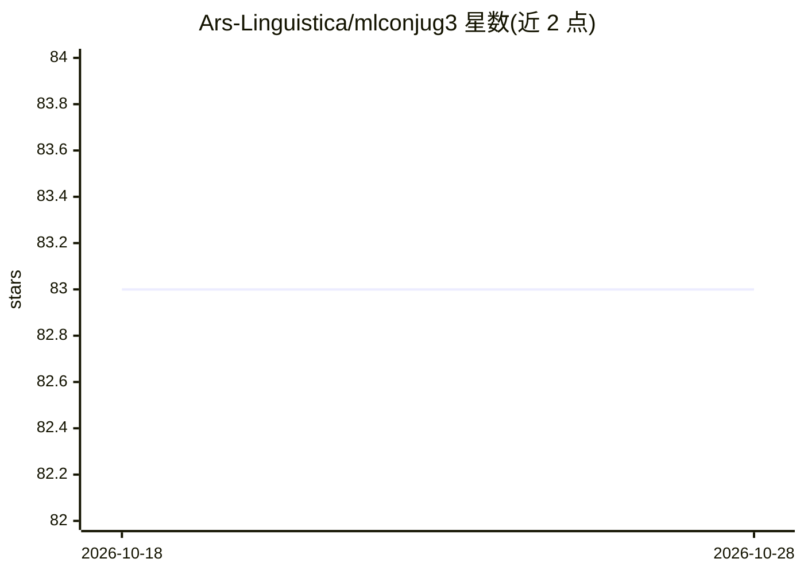

# Ars-Linguistica/mlconjug3

⭐ 83 · Python · MIT · 推送 2026-08-09 · [GitHub](https://github.com/Ars-Linguistica/mlconjug3) · 个人维护

**多语种动词变位库：ML 模型预测法/英/西/意/葡/罗语变位**

Python 库兼命令行工具，使用预训练机器学习模型对法语、英语、西班牙语、意大利语、葡萄牙语和罗马尼亚语动词进行变位，可处理全新或虚构动词。模型基于 scikit-learn 分类器（SGDClassifier/elasticnet），用户可用任意兼容 sklearn 分类器重训模型。支持 Python 3.9–3.14（Windows 3.13+ 为实验性，存在 SciPy 二进制兼容问题）。面向语言研究者、教师与应用开发者，提供 pip/conda/源码安装，自 v3.10 起用 Sigstore 签名发布。

## 筛选速览

| 维度 | 判定 | 备注 |
|---|---|---|
| AI 角色 | `ai-native` | 本体是模型或模型工具 |
| 许可风险 | `permissive` | MIT |
| 部署形态 | `library` | 以包/库形式分发 |
| 模型依赖 | — | README 未给出锁定关系 |
| 硬件要求 | — | 无带数字的原话,不猜 |
| 安装摩擦 | `low` | 无编译、无系统依赖或容器化 |
| 成熟度 | — | 结构信号不足 |

## 能力要点

- 预训练 ML 模型预测 6 种语言的动词变位，支持未见过的虚构动词
- 可用任意兼容 scikit-learn 分类器修改并重训模型
- 提供 Python 库与命令行两种使用形式
- 发布包经 Sigstore 签名，可用 cosign 验证

## 适用场景

- 在语言学习应用中查询动词变位
- 语言学研究中比较跨语言变位模式
- 翻译工具中保证动词变位语法正确

## 场景标签

 · 领域:NLP/语言学工具

## 证据(README 行号)

> L55: A Command Line application and Python library to conjugate verbs in French, English, Spanish, Italian, Portuguese, 
> L61: - Conjugate any verb in one of the supported languages, even completely new or made-up verbs, with the help of a pr

## 星数曲线

2026-10-18 83 → 2026-10-28 83（+0）

---
*卡片 v1 · prompt 1.4 · 生成 2026-10-24 · 置信度 high · 依据 README sha `4fe8c5b894b1` · [字段定义](../../DATASET.md)*
