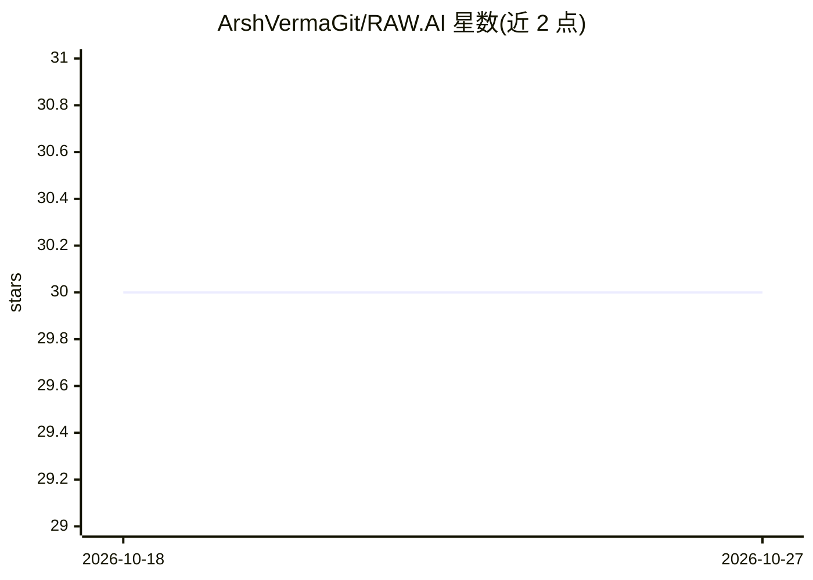

# ArshVermaGit/RAW.AI

⭐ 30 · TypeScript · MIT · 推送 2026-04-15 · [GitHub](https://github.com/ArshVermaGit/RAW.AI) · [官网](https://rawai-arshvermagit.vercel.app) · 个人维护

**将 AI 生成文本改写为**

面向学生、职场人士和内容创作者的 Web 平台（React + Vite + TypeScript 前端，Supabase 负责后端与认证，Razorpay 支付）：核心功能是把 AI 生成的文本改写为更接近人类写作风格的文本，自称可规避 GPTZero、Turnitin 等 AI 检测工具；内置针对多家检测器的实时检测分析、Standard/Academic/Creative/Business 四种改写模式，并设 Lite/Pro/Ultra 三档付费方案。本地运行需 Node.js 18+ 并配置 Supabase 环境变量。

## 筛选速览

| 维度 | 判定 | 备注 |
|---|---|---|
| AI 角色 | `ai-native` | 本体是模型或模型工具 |
| 许可风险 | `permissive` | MIT |
| 部署形态 | `library` | 以包/库形式分发 |
| 模型依赖 | — | README 未给出锁定关系 |
| 硬件要求 | — | 无带数字的原话,不猜 |
| 安装摩擦 | `low` | 无编译、无系统依赖或容器化 |
| 成熟度 | — | 结构信号不足 |

## 能力要点

- 将 AI 生成文本改写为接近人类写作的文本，自称 99.9% 检测规避率
- 内置针对 GPTZero、Turnitin 等检测器的实时检测分析
- Standard/Academic/Creative/Business 四种改写模式
- Supabase 认证与 Razorpay 支付集成

## 适用场景

- 把 AI 生成的文章改写成更像人写的文本
- 在提交前检测文本是否会被 AI 检测工具识别
- 按学术、创意、商务等不同风格改写内容

## 场景标签

`AI 写作` · 领域:内容生成

## 证据(README 行号)

> L10: > **Bypass AI detection with human-grade rewriting.**
> L21: - **🤖 Advanced Humanization**: Convert AI text to human-like quality with a 99.9% detection bypass rate.
> L36: - **Frontend**: React, TypeScript, Vite

## 星数曲线

2026-10-18 30 → 2026-10-27 30（+0）

---
*卡片 v1 · prompt 1.4 · 生成 2026-10-26 · 置信度 high · 依据 README sha `ade0194b89df` · [字段定义](../../DATASET.md)*
