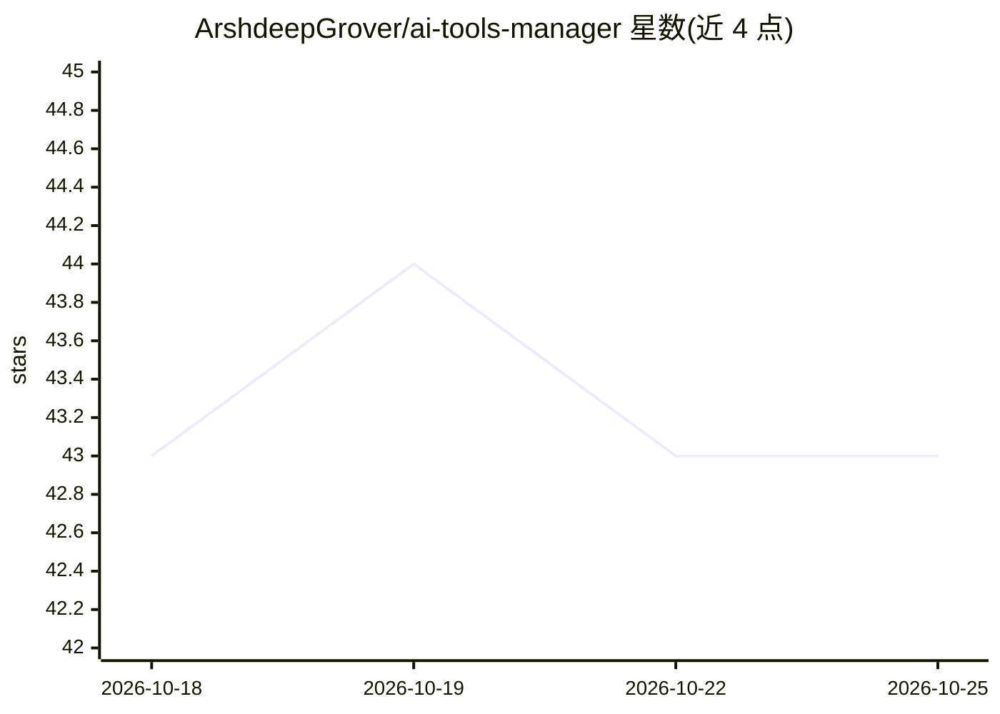

# ArshdeepGrover/ai-tools-manager

⭐ 43 · JavaScript · MIT · 推送 2026-10-15 · [GitHub](https://github.com/ArshdeepGrover/ai-tools-manager) · [官网](https://ai-tool-collection.vercel.app/) · 个人维护

**社区维护的免费 AI 工具导航目录网站（100+ 工具，10 类）**

一个开源的静态网站项目，收录 100+ 个免费或免费试用的 AI 工具链接，按写作、设计图像、编程、音视频、本地模型等 10 个类别组织，提供搜索过滤与响应式页面，支持 PWA。数据存放在 data/links.json，通过 Pull Request 社区共建；附带 npm 校验脚本检查重复条目、链接可访问性与数据结构。本地开发需克隆仓库，可选 npm install，直接用浏览器打开 index.html 即可运行。

## 筛选速览

| 维度 | 判定 | 备注 |
|---|---|---|
| AI 角色 | `ai-knowledge` | 知识聚合/清单类 |
| 许可风险 | `permissive` | MIT |
| 部署形态 | `library` | 以包/库形式分发 |
| 模型依赖 | — | README 未给出锁定关系 |
| 硬件要求 | — | 无带数字的原话,不猜 |
| 安装摩擦 | `low` | 无编译、无系统依赖或容器化 |
| 成熟度 | — | 结构信号不足 |

## 能力要点

- 收录 100+ 免费 AI 工具，按 10 个类别组织
- 内置搜索与过滤功能，支持 PWA
- 自动化校验脚本：重复检测、链接可访问性、JSON 结构验证
- 通过 PR 与 contributors.json 记录社区贡献者

## 适用场景

- 按类别浏览和发现免费的 AI 写作、设计、编程等工具
- 开发者向目录提交自己制作的 AI 工具
- 了解当前社区收录的 AI 工具覆盖范围

## 场景标签

`精选清单` · 领域:学习与行业

## 证据(README 行号)

> L21: A curated collection of powerful AI tools, maintained by the community. This project welcomes contributions from de
> L44: - **100+** Free AI Tools

## 星数曲线

2026-10-18 43 → 2026-10-25 43（+0）

---
*卡片 v1 · prompt 1.4 · 生成 2026-10-25 · 置信度 high · 依据 README sha `e7f7bb9cd54d` · [字段定义](../../DATASET.md)*
