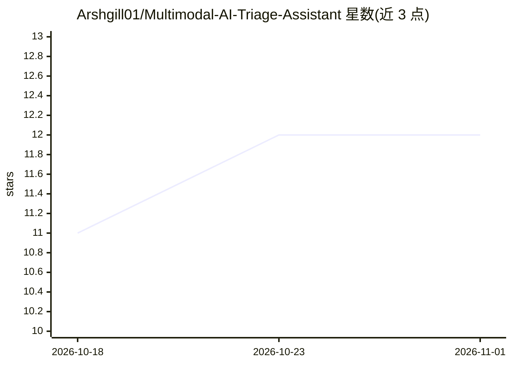

# Arshgill01/Multimodal-AI-Triage-Assistant

⭐ 12 · Python · MIT · 推送 2026-09-06 · [GitHub](https://github.com/Arshgill01/Multimodal-AI-Triage-Assistant) · 个人维护

**多模态急诊分诊决策支持系统：预测 ESI 等级**

融合结构化生命体征、ClinicalBERT 文本嵌入与 ResNet-50 图像特征，经 LightGBM 晚期融合预测急诊严重指数（ESI 1-5）。架构为 Rust Axum 后端（FFI 推理、路由、SQLite 审计）加 Python FastAPI sidecar（HuggingFace 模型预处理），前端为 Next.js HUD。提供实时 SHAP 逐患者解释、双路混合检索（文本相似度+生理 z-score）的临床 RAG（Gemini 生成、含用药/诊断禁令）、临床医生人工覆盖与 MCI 批量分诊模式。训练数据为 197 例 MIMIC-IV-ED 真实患者加 1,000 例合成患者。

## 筛选速览

| 维度 | 判定 | 备注 |
|---|---|---|
| AI 角色 | `ai-native` | 本体是模型或模型工具 |
| 许可风险 | `permissive` | MIT |
| 部署形态 | `library` | 以包/库形式分发 |
| 模型依赖 | — | README 未给出锁定关系 |
| 硬件要求 | — | 无带数字的原话,不猜 |
| 安装摩擦 | `low` | 无编译、无系统依赖或容器化 |
| 成熟度 | — | 结构信号不足 |

## 能力要点

- 三模态晚期融合（7 生命体征+10 文本 PCA+5 图像 PCA）→ LightGBM ESI 预测
- 实时 SHAP 局部/全局解释与置信度指标
- 双路混合检索 RAG：ClinicalBERT 余弦相似度 + 生理 z-score 元数据过滤
- 人工覆盖流程与 SQLite 审计日志、MCI 批量分诊（10-100 患者并行）

## 适用场景

- 急诊科对患者做 ESI 等级分诊辅助决策
- 群体伤亡事件下批量分诊并查看 ESI 分布
- 临床医生复核 AI 分诊建议并记录覆盖理由

## 场景标签

`RAG` `多模态` · 领域:知识与检索

## 证据(README 行号)

> L3: A production-grade late-fusion multimodal AI system that predicts Emergency Severity Index (ESI) levels for emergenc
> L198: |LLM Generation|Google Gemini 2.5 Flash|Guardrailed clinical recommendations|

## 星数曲线

2026-10-18 11 → 2026-11-01 12（+1）

---
*卡片 v1 · prompt 1.4 · 生成 2026-11-01 · 置信度 mid · 依据 README sha `b885eb4b3394` · [字段定义](../../DATASET.md)*
