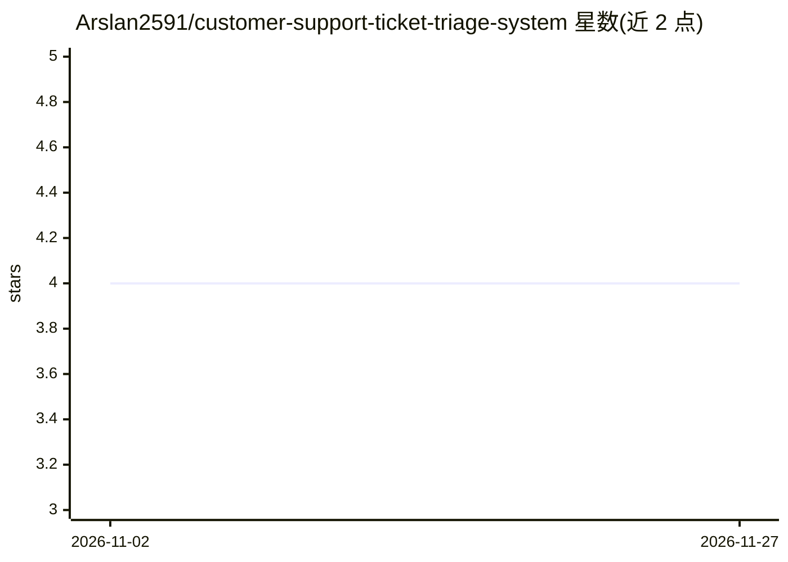

# Arslan2591/customer-support-ticket-triage-system

⭐ 4 · Python · MIT · 推送 2026-10-30 · [GitHub](https://github.com/Arslan2591/customer-support-ticket-triage-system) · 个人维护

**为客服团队自动分类、分级并路由支持工单的可解释系统**

面向客服运营的工单分诊系统：scikit-learn 模型给出类别、优先级与置信度，外层确定性规则对 VIP 客户与紧急关键词强制升级，规则只能提升优先级不能降低；置信度不足时转入人工审核队列而非自动派发。每次决策记录 top token 信号、触发规则与路由理由，覆盖与修正写入带关联 ID 的审计日志并作为再训练反馈。提供 FastAPI 接口与 Streamlit 操作台，评估基于合成数据，优先级 F1 较低由规则层兜底。

## 筛选速览

| 维度 | 判定 | 备注 |
|---|---|---|
| AI 角色 | `ai-native` | 本体是模型或模型工具 |
| 许可风险 | `permissive` | MIT |
| 部署形态 | `library` | 以包/库形式分发 |
| 模型依赖 | — | README 未给出锁定关系 |
| 硬件要求 | — | 无带数字的原话,不猜 |
| 安装摩擦 | `low` | 无编译、无系统依赖或容器化 |
| 成熟度 | — | 结构信号不足 |

## 能力要点

- 每条决策输出置信度、top token 信号、触发规则与路由理由
- 确定性规则层强制 VIP/紧急工单升级，只升不降
- 低置信度工单进入人工审核队列，覆盖记录为再训练反馈
- FastAPI 服务 + Streamlit 操作台 + SQLite 审计日志

## 适用场景

- 替换人工排队分诊，自动给工单分类、定级并派发给团队
- 客服主管查看路由质量、覆盖率与审核积压指标
- 对紧急/VIP 工单做不可绕过的自动升级兜底

## 场景标签

`工作流自动化` · 领域:效率与自动化

## 证据(README 行号)

> L3: Automatically **classifies, prioritizes, and routes** incoming support tickets — with an explainable decision path a
> L37: **Key idea:** a scikit-learn model *proposes*, and a small deterministic rule layer *disposes*. The model gives us 

## 星数曲线

2026-11-02 4 → 2026-11-27 4（+0）

---
*卡片 v1 · prompt 1.4 · 生成 2026-11-21 · 置信度 high · 依据 README sha `6944c72929ae` · [字段定义](../../DATASET.md)*
