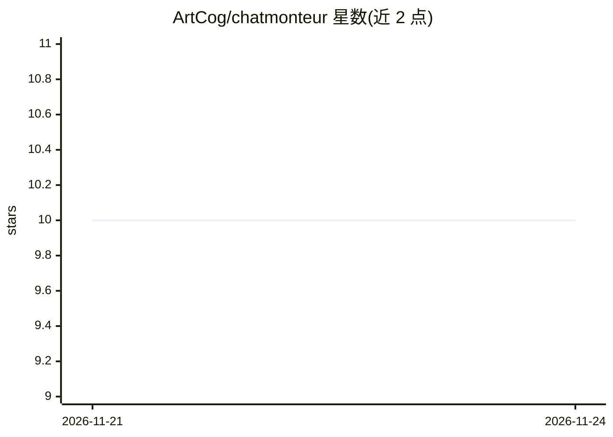

# ArtCog/chatmonteur

⭐ 10 · HTML · MIT · 推送 2026-08-21 · [GitHub](https://github.com/ArtCog/chatmonteur) · 个人维护 · 中文 README

**给 talking-head 视频创作者的 agent 编排剪辑工具**

面向真人出镜录像（vlog、教程、讲解）的剪辑工作室：用户放入原始素材并用自然语言下达指令，由 Claude Code / Codex 等 coding agent 执行一条流程——转录、按语义剪掉停顿与口误、加字幕、动效图形、声音、调色、渲染。它不重造引擎，而是编排 faster-whisper、auto-editor、hyperframes、ffmpeg 等开源工具，并附 `skills/` 编辑决策知识库与两道质量门（计划门、文件门）拦截不合格成片。v0.1 通过仓库 checkout 分发，剪辑结果为机械草稿后由 agent 完成收尾。

## 筛选速览

| 维度 | 判定 | 备注 |
|---|---|---|
| AI 角色 | `ai-enhanced` | 去掉 AI 部分产品仍成立 |
| 许可风险 | `permissive` | MIT |
| 部署形态 | `None` |  |
| 模型依赖 | locked-api |  |
| 硬件要求 | — | 无带数字的原话,不猜 |
| 安装摩擦 | `medium` | 含编译或系统依赖之一 |
| 成熟度 | `idea` | |

## 能力要点

- 由 coding agent（Claude Code / Codex）编排的语义剪辑流程，含字幕、动效、声音、渲染
- 内置 `skills/` 编辑决策知识库供 agent 遵循
- 两道质量门：计划门评分拒绝弱方案，文件门抽帧/音频级检测拦截破损成片并生成 `.qc.json` 报告
- 本地 faster-whisper 转录，默认无需付费 API key

## 适用场景

- 把原始口播录像一键剪成可发布的成片
- 按语义去掉停顿与口误并同步字幕与图形
- 本地离线转录与编码，避免付费 API

## 场景标签

`视频生成` `图像视频处理` · 领域:内容生成

## 证据(README 行号)

> L6: **ChatMonteur** (*monteur* — French/Russian for "film editor") is an extensible,
> L13: It does **not** reinvent the engines. It orchestrates proven open tools —
> L16: faster-whisper, and ffmpeg — while adapting

## 星数曲线

2026-11-21 10 → 2026-11-24 10（+0）

---
*卡片 v1 · prompt 1.4 · 生成 2026-11-21 · 置信度 high · 依据 README sha `900ca5904651` · [字段定义](../../DATASET.md)*
