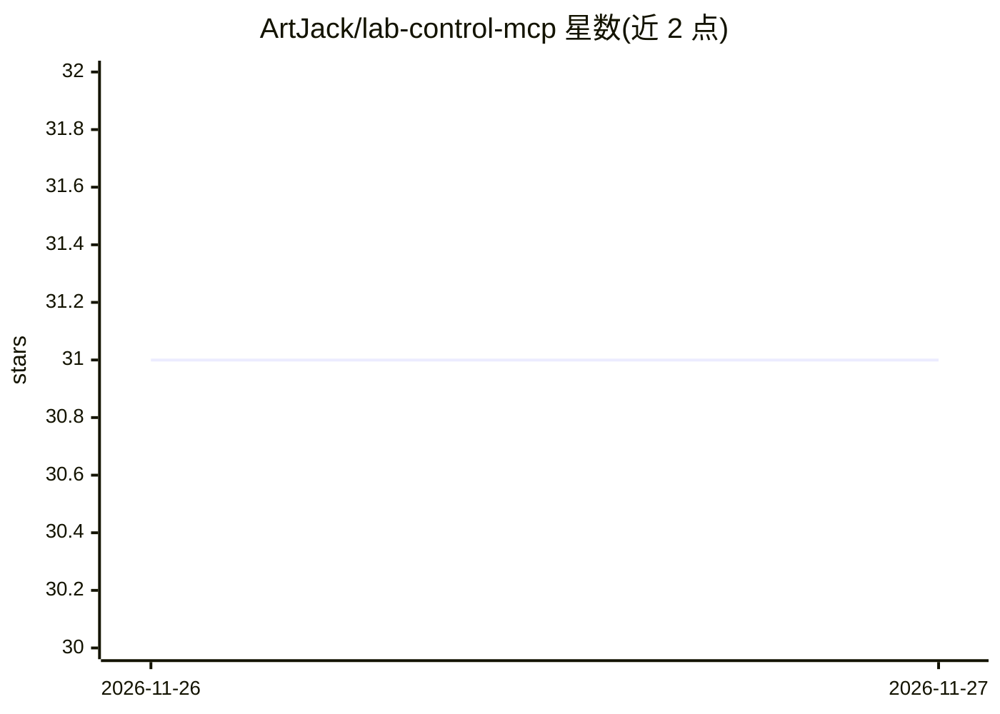

# ArtJack/lab-control-mcp

⭐ 31 · Python · MIT · 推送 2026-09-18 · [GitHub](https://github.com/ArtJack/lab-control-mcp) · [官网](https://artjeck.com) · 个人维护

**MCP server：通过对话客户端远程运维家庭 AI 实验室**

提供一组 MCP 工具，用于检查本地实验室各服务（LiteLLM 网关、Ollama、Qdrant、Postgres）的健康状态、管理模型（拉取模型）、经 LiteLLM 网关做本地推理，并通过受安全门控的远程 shell 在两台主机上执行命令。安全机制包括命令前缀白名单、拒绝 shell 元字符、无 shell=True 的 argv 执行与超时截断。支持 stdio 与带令牌保护的 HTTP 传输，可经 Tailscale 远程接入。安装使用 uv。

## 筛选速览

| 维度 | 判定 | 备注 |
|---|---|---|
| AI 角色 | `ai-ecosystem` | LLM/agent 周边工具 |
| 许可风险 | `permissive` | MIT |
| 部署形态 | `None` |  |
| 模型依赖 | local-ok | 支持本地模型 |
| 硬件要求 | — | 无带数字的原话,不猜 |
| 安装摩擦 | `low` | 无编译、无系统依赖或容器化 |
| 成熟度 | — | 结构信号不足 |

## 能力要点

- lab_status/list_models/gpu_generate/pull_model 等 MCP 工具集
- 门控 shell：前缀白名单、拒绝元字符、argv 执行、超时截断
- 推理统一经 LiteLLM 网关，继承本地优先路由与预算上限
- stdio 与 Streamable HTTP（bearer 令牌 + DNS-rebinding 主机白名单）两种传输

## 适用场景

- 外出时通过 MCP 客户端查看实验室各服务健康状态
- 远程为两台主机拉取 Ollama 模型
- 经网关调用免费的本地 chat/code/embed 推理
- 以白名单限制的方式在主机上执行运维命令

## 场景标签

 · 领域:LLM 基础设施/运维工具

## 证据(README 行号)

> L3: An **MCP server that operates the home AI lab** — health checks, model management,
> L18: |`lab_status`|read|Health of gateway (LAN + Tailscale), Ollama (M4 + GTX), Qdrant, Postgres exposure.|

## 星数曲线

2026-11-26 31 → 2026-11-27 31（+0）

---
*卡片 v1 · prompt 1.4 · 生成 2026-11-26 · 置信度 high · 依据 README sha `f6db3dc8e6db` · [字段定义](../../DATASET.md)*
