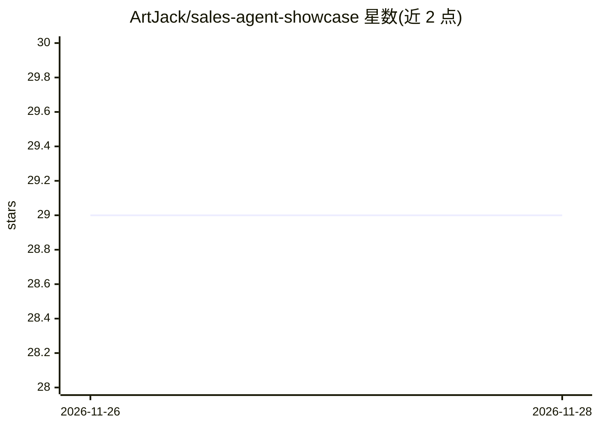

# ArtJack/sales-agent-showcase

⭐ 29 · Python · MIT · 推送 2026-09-05 · [GitHub](https://github.com/ArtJack/sales-agent-showcase) · [官网](https://artjeck.com/work/sales) · 个人维护

**给开发者的多市场转售自动化架构净化展示仓**

将一套已投入生产运行的转售业务系统以 clean-room 方式重写的展示仓库：以适配器模式对接多个市场平台，一次录入商品后由编排器按各平台策略生成并发布列表，内置指数退避重试、基于台账的幂等（重跑不重复上架）、不可逆操作的结构化人工审批门。真实市场集成为私有代码，仓库内全部为假适配器与合成数据，纯标准库即可运行 demo，附 30 个测试。

## 筛选速览

| 维度 | 判定 | 备注 |
|---|---|---|
| AI 角色 | `ai-enhanced` | 去掉 AI 部分产品仍成立 |
| 许可风险 | `permissive` | MIT |
| 部署形态 | `library` | 以包/库形式分发 |
| 模型依赖 | — | README 未给出锁定关系 |
| 硬件要求 | — | 无带数字的原话,不猜 |
| 安装摩擦 | `low` | 无编译、无系统依赖或容器化 |
| 成熟度 | — | 结构信号不足 |

## 能力要点

- 适配器模式：新增平台只需新适配器，核心管线不改
- 台账幂等：按 (sku, marketplace) 键控，重跑不重复发布
- 不可逆操作走审批队列与执行授权，拒绝逻辑内置于适配器
- 标题/价格/标签由确定性规则生成，30 个测试覆盖关键路径

## 适用场景

- 学习跨平台发布的重试/幂等/审批门工程设计
- 参考适配器模式对接多个电商平台的架构
- 了解 AI agent 场景下限制模型触碰关键交易字段的做法

## 场景标签

`工作流自动化` · 领域:效率与自动化

## 证据(README 行号)

> L59: - **Irreversible actions are human-gated, structurally.** Publishing a new listing
> L68: - **Deterministic listings — an LLM never touches a field a buyer pays against.**
> L70:  improvising on the numbers a sale depends on. (Production adds an *optional* LLM

## 星数曲线

2026-11-26 29 → 2026-11-28 29（+0）

---
*卡片 v1 · prompt 1.4 · 生成 2026-11-26 · 置信度 mid · 依据 README sha `a66bee5d0ae4` · [字段定义](../../DATASET.md)*
