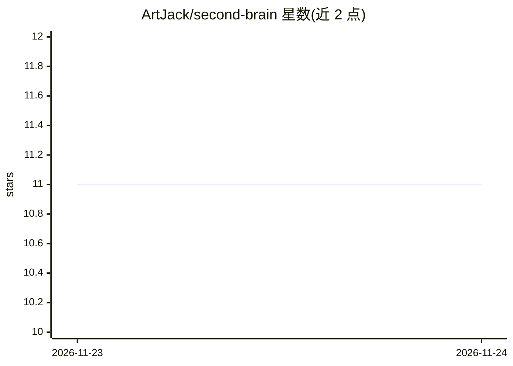

# ArtJack/second-brain

⭐ 11 · Python · MIT · 推送 2026-11-24 · [GitHub](https://github.com/ArtJack/second-brain) · [官网](https://artjeck.com) · 个人维护

**本地优先的个人 RAG 问答助手，答案强制引用自有文档**

面向个人的 RAG 助手：指向自己的笔记、文档与代码后提问，回答被强制要求仅基于检索上下文并附 [n] 引用，CLI 打印来源文件与距离。检索采用向量加 SQLite FTS5 关键词的混合方案，倒数排名融合，可用 SB_HYBRID 开关。默认经 OpenAI 兼容端点调用本地模型，也可切换 LiteLLM 网关路由到付费模型；另以 MCP server 形式暴露给 MCP 客户端，附带评测框架、定时摄取 worker、晨报与任务存储。

## 筛选速览

| 维度 | 判定 | 备注 |
|---|---|---|
| AI 角色 | `ai-native` | 本体是模型或模型工具 |
| 许可风险 | `permissive` | MIT |
| 部署形态 | `library` | 以包/库形式分发 |
| 模型依赖 | local-ok | 支持本地模型 |
| 硬件要求 | — | 无带数字的原话,不猜 |
| 安装摩擦 | `low` | 无编译、无系统依赖或容器化 |
| 成熟度 | — | 结构信号不足 |

## 能力要点

- 强制引用机制：无来源则不产出声明，CLI 打印来源文件与距离
- 向量 + SQLite FTS5 混合检索，倒数排名融合，SB_HYBRID 可开关
- OpenAI 兼容网关：默认本地 Ollama，可切 LiteLLM 网关且零代码改动
- MCP server 暴露 ask/recall/ingest/learn 等工具，附评测框架

## 适用场景

- 对个人笔记与工程文档提问并获得带引用的回答
- 通过 Claude Code 等 MCP 客户端查询自己的知识库
- 定时扫描文件夹摄取新文件并生成每日简报
- 以评测框架对 RAG 回答质量做基准与轨迹检查

## 场景标签

`RAG` `文档问答` `模型评测` · 领域:评测与运维

## 证据(README 行号)

> L3: A personal RAG assistant: point it at your notes, docs, and code, then ask questions and
> L20: - **Citations are mandatory.** The system prompt forces the model to answer *only* from
> L57: - [x] Wrap as an **MCP server** so Claude Desktop / Claude Code can query your brain directly (docs)

## 星数曲线

2026-11-23 11 → 2026-11-24 11（+0）

---
*卡片 v1 · prompt 1.4 · 生成 2026-11-23 · 置信度 mid · 依据 README sha `7f8a4a99461f` · [字段定义](../../DATASET.md)*
