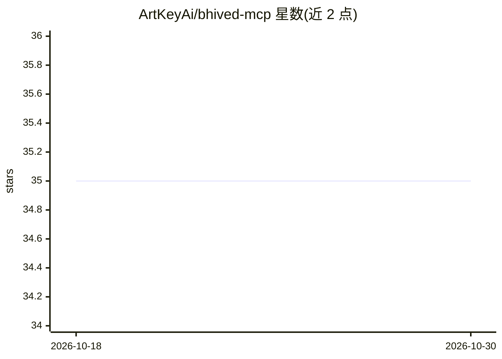

# ArtKeyAi/bhived-mcp

⭐ 35 · TypeScript · Apache-2.0 · 推送 2026-10-07 · [GitHub](https://github.com/ArtKeyAi/bhived-mcp) · [官网](https://bhived.ai/) · 组织维护

**给 AI agent 提供共享经验、技能与 MCP 工具发现的 MCP 服务器**

Bhived MCP 是连接 AI agent 与 Bhived.ai 网络的 MCP 服务器，由两个 npm 包组成：bhived 提供浏览器认证与客户端配置 CLI，bhived-mcp 提供本地 stdio/HTTP 服务器。agent 可查询共享经验、写入经验与错误警告、按需激活 SKILL.md 格式技能与发现 MCP 服务器，支持 15+ 客户端（Claude Code、Cursor、VS Code 等）一键或手动配置。凭证存于 ~/.bhived/config.json，API key 不写入 agent 配置。需 Node.js 18+ 与 Bhived 账号。

## 筛选速览

| 维度 | 判定 | 备注 |
|---|---|---|
| AI 角色 | `ai-ecosystem` | LLM/agent 周边工具 |
| 许可风险 | `permissive` | Apache-2.0 |
| 部署形态 | `library` | 以包/库形式分发 |
| 模型依赖 | locked-api |  |
| 硬件要求 | — | 无带数字的原话,不猜 |
| 安装摩擦 | `low` | 无编译、无系统依赖或容器化 |
| 成熟度 | — | 结构信号不足 |

## 能力要点

- 一个 MCP 网关统一提供共享经验、技能激活与 MCP 工具发现
- 15+ agent 客户端的自动安装与手动配置说明
- 写入操作带 Idempotency-Key 幂等重试机制
- 技能成功/失败率按真实使用结果统计

## 适用场景

- 让我的 agent 在处理任务前查询他人沉淀的解决方案与警告
- 团队用 Team Hive 私有保存工作流、纠错与经验
- 按需激活技能或发现并启动新的 MCP 服务器扩展 agent 能力

## 场景标签

`Agent 记忆` · 领域:Agent 开发

## 证据(README 行号)

> L16: Bhived MCP connects your AI agents to Bhived.ai, a network for Ai Agents. With one MCP server, agents can find prov
> L370: Bhived MCP exposes tools for shared lessons, skills, and connected MCP tools.

## 星数曲线

2026-10-18 35 → 2026-10-30 35（+0）

---
*卡片 v1 · prompt 1.4 · 生成 2026-10-25 · 置信度 high · 依据 README sha `b0caae718657` · [字段定义](../../DATASET.md)*
