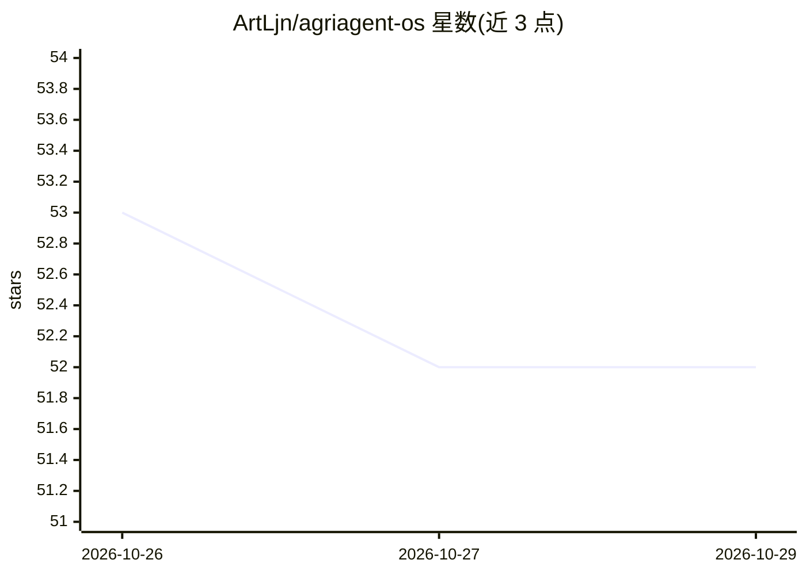

# ArtLjn/agriagent-os

⭐ 52 · Python · 推送 2026-10-25 · [GitHub](https://github.com/ArtLjn/agriagent-os) · [官网](https://farm.lllcnm.cn) · 个人维护 · 中文 README

**面向农场日常经营的 AI 助手与管理工作台**

仓库包含 React 管理后台、Flutter App，以及通过 MCP 协作的 Business/Agent 双服务：Business 用 FastAPI+MySQL 管理作物、种植周期、农事日志、收支、天气等农场业务数据；Agent 负责流式对话、工具路由、写操作审批、长期记忆（MongoDB，可接 QuillRAG 语义召回）与 Trace/Token 可观测性。用户通过对话查询和执行农事操作。本地启动需 Python 3.11+/uv/Node.js/pnpm/MySQL/MongoDB，配置模型服务后分别运行双服务、管理端与可选 App；仓库的 docker-compose 属旧后端配置。

## 筛选速览

| 维度 | 判定 | 备注 |
|---|---|---|
| AI 角色 | `ai-enhanced` | 去掉 AI 部分产品仍成立 |
| 许可风险 | `none` | — |
| 部署形态 | `self-host` | docker 或自建部署 |
| 模型依赖 | — | README 未给出锁定关系 |
| 硬件要求 | — | 无带数字的原话,不猜 |
| 安装摩擦 | `low` | 无编译、无系统依赖或容器化 |
| 成熟度 | — | 结构信号不足 |

## 能力要点

- Agent 经 MCP Skill 调用 Business 工具读写真实农场数据，写操作走审批流程
- 长期记忆保存于 MongoDB，可接 QuillRAG 语义召回，支持查看/修改/删除与临时对话
- Trace 链路追踪、记忆上下文详情与按用户/模型的 Token 用量统计
- 覆盖作物模板、种植周期、农事日志、收支用工、天气预警与备忘录的经营管理模块

## 适用场景

- 通过对话查询农事记录、盘点待结款项并整理农场计划
- 用同一套系统管理作物、茬口、账本、工人工资与日常提醒
- 在 Playground 调试工具调用，用 Trace 排查记忆检索与执行问题

## 场景标签

`AI 助手` · 领域:对话与助手

## 证据(README 行号)

> L21: 田掌柜是面向农场日常经营的 AI 助手与管理工作台。它把作物、种植周期、农事记录、收支、天气和提醒放在同一套系统中，让使用者通过对话查询信息、整理计划，并在授权后执行操作。
> L31: |农场经营|仪表盘、作物模板、种植周期、农事日志、收支与用工管理|
> L91: 农场数据由 Business 服务统一管理，管理后台、App 和 Agent 工具共享业务规则。可以从页面直接维护，也可以让助手根据自然语言查询和组织操作。

## 星数曲线

2026-10-26 53 → 2026-10-29 52（-1）

---
*卡片 v1 · prompt 1.4 · 生成 2026-10-25 · 置信度 mid · 依据 README sha `e341cdb4de02` · [字段定义](../../DATASET.md)*
