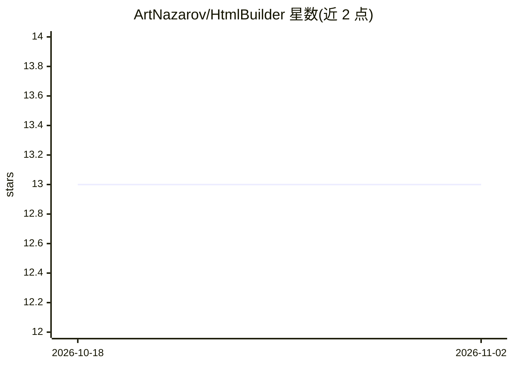

# ArtNazarov/HtmlBuilder

⭐ 13 · Pascal · NOASSERTION · 推送 2026-01-27 · [GitHub](https://github.com/ArtNazarov/HtmlBuilder) · [官网](https://apprr.rf.gd/HtmlBuilder/) · 个人维护 · 中文 README

**FreePascal 编写的静态网站生成器，含本地服务器与 Ollama AI 助手**

基于 FreePascal/Lazarus 的桌面静态网站生成器：内容存于 SQLite 数据库（图片与附件存 BLOB），支持模板、参数化块、@repeat/@ifelse/@db 模板操作符、按类别与字段过滤、菜单构造器与多语言界面（英/西/中/韩）。内置 Web 服务器供预览，通过 FTP 或 PHP/Node.js/Python bridge 上传内容，可发布到 GitHub Pages。AI 部分为连接 Ollama 服务器的聊天助手，需用户自行安装 Ollama 并加载模型。Linux 提供安装器与预发布包，也可在 Lazarus IDE 中编译。

## 筛选速览

| 维度 | 判定 | 备注 |
|---|---|---|
| AI 角色 | `ai-enhanced` | 去掉 AI 部分产品仍成立 |
| 许可风险 | `none` | NOASSERTION |
| 部署形态 | `None` |  |
| 模型依赖 | local-ok | 支持本地模型 |
| 硬件要求 | — | 无带数字的原话,不猜 |
| 安装摩擦 | `low` | 无编译、无系统依赖或容器化 |
| 成熟度 | — | 结构信号不足 |

## 能力要点

- 内容引擎基于 SQLite，图片与附件以 BLOB 存储
- 模板操作符 @repeat/@ifelse/@db 按条件与 SQL 查询渲染内容
- 内置 Web 服务器与 FTP/bridge API 多种发布通道
- 与 Ollama 服务器对话的 AI 助手

## 适用场景

- 在桌面端编辑并生成静态网站，发布到 P2P 网络或 Vercel 等 jamstack 托管
- 通过类别与字段过滤组织站点内容
- 在编辑器内与本地 Ollama 模型对话辅助建站

## 场景标签

`AI 助手` · 领域:对话与助手

## 证据(README 行号)

> L3: Written in FreePascal/Lazarus generator of static html websites
> L5: AI assistant with Ollama mode / ИИ ассистент в режиме Ollama
> L117: 24. Chat with Ollama AI server / Чат с AI сервером Ollama

## 星数曲线

2026-10-18 13 → 2026-11-02 13（+0）

---
*卡片 v1 · prompt 1.4 · 生成 2026-10-31 · 置信度 high · 依据 README sha `8e92bcef6872` · [字段定义](../../DATASET.md)*
