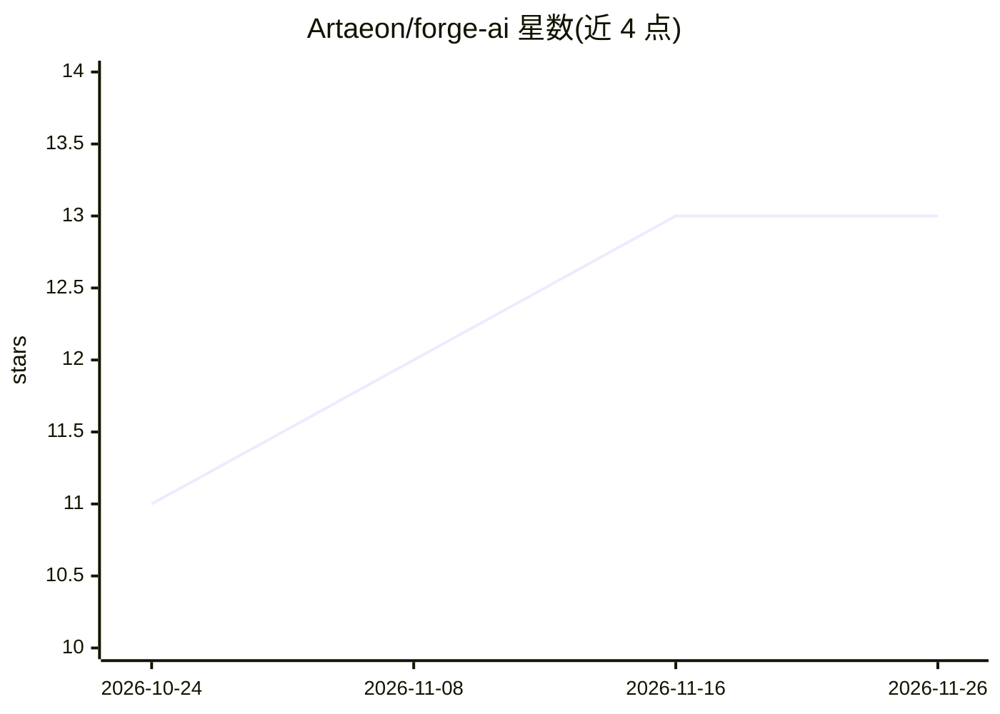

# Artaeon/forge-ai

⭐ 13 · Python · MIT · 推送 2026-02-16 · [GitHub](https://github.com/Artaeon/forge-ai) · 个人维护

**多 AI 编码助手的命令行编排器：统一调度与协作**

以 Python CLI 形式提供的多智能体编排器，将 Claude Code、Gemini CLI、Antigravity、GitHub Copilot 等编码助手接入统一命令入口，支持 single/parallel/chain/review/consensus/swarm 六种编排模式；duo 流水线按 plan→code→verify→review→fix 循环协作，迭代生成代码并运行测试与 lint 验证、错误分类与回滚。提供 HTML 仪表盘、5 个基准任务、A/B 提示词对比、插件钩子、跨会话持久记忆与逐 agent 成本跟踪。要求 Python 3.11+，需至少一个 agent CLI 或 API key。

## 筛选速览

| 维度 | 判定 | 备注 |
|---|---|---|
| AI 角色 | `ai-ecosystem` | LLM/agent 周边工具 |
| 许可风险 | `permissive` | MIT |
| 部署形态 | `library` | 以包/库形式分发 |
| 模型依赖 | locked-api |  |
| 硬件要求 | — | 无带数字的原话,不猜 |
| 安装摩擦 | `low` | 无编译、无系统依赖或容器化 |
| 成熟度 | — | 结构信号不足 |

## 能力要点

- 6 种编排模式（单发/并行/链式/评审/共识/集群）
- duo 流水线：planner+coder 循环直至测试通过
- 5 个标准基准与 A/B 提示词变体对比
- 跨会话持久记忆与逐 agent 成本/预算跟踪

## 适用场景

- 同时向多个 AI 编码助手派发任务并择优取结果
- 用 verify→review→fix 循环自动从零搭建带测试的项目
- 按质量分数与成本对比不同模型和提示词策略

## 场景标签

`多智能体` `编码 Agent` · 领域:Agent 开发

## 证据(README 行号)

> L5:  Multi-Agent AI Coding Orchestrator
> L15: Modern AI coding assistants are powerful individually — but **they're even better together.** Forge lets you dispat
> L42: ### Agent Prerequisites

## 星数曲线

2026-10-24 11 → 2026-11-26 13（+2）

---
*卡片 v1 · prompt 1.4 · 生成 2026-11-18 · 置信度 mid · 依据 README sha `f907d94a0f29` · [字段定义](../../DATASET.md)*
