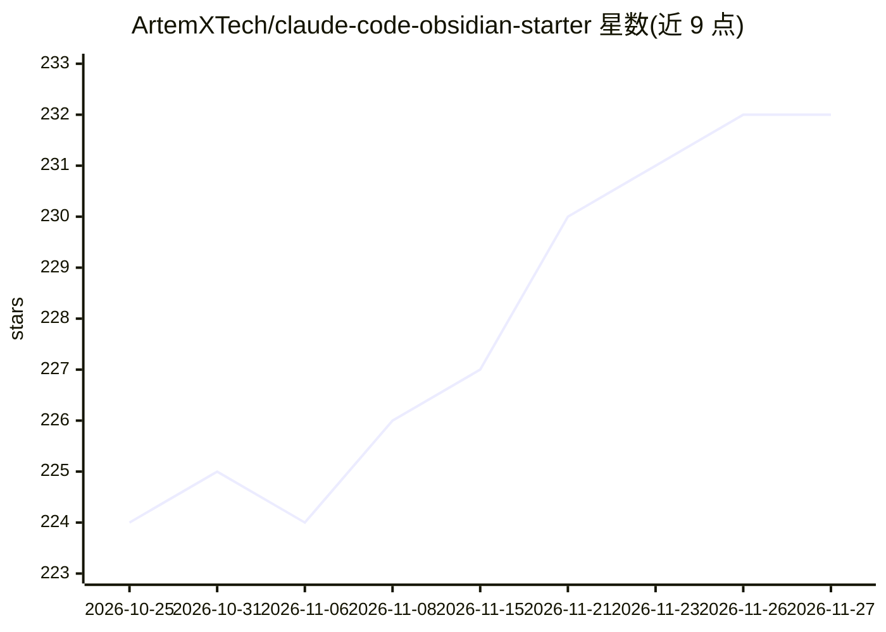

# ArtemXTech/claude-code-obsidian-starter

⭐ 232 · Typst · 推送 2026-11-01 · [GitHub](https://github.com/ArtemXTech/claude-code-obsidian-starter) · [官网](https://artemxtech.substack.com) · 个人维护

**Claude Code + Obsidian 预配置启动模板：项目管理与日常例程**

一个免费入门套件，提供预配置的 Obsidian 库（vault），与 Claude Code 配合使用。内置 4 个技能：query（查找项目、客户、任务）、tasknotes（创建与管理任务）、review（早/晚/周例程）、client（客户跟进与邮件）。通过 git clone 获取后在 Obsidian 中打开、运行 claude 命令即可使用，并提供含截图的 PDF 安装指南。面向使用 Obsidian 管理个人工作流的 Claude Code 用户。

## 筛选速览

| 维度 | 判定 | 备注 |
|---|---|---|
| AI 角色 | `ai-enhanced` | 去掉 AI 部分产品仍成立 |
| 许可风险 | `none` | — |
| 部署形态 | `None` |  |
| 模型依赖 | — | README 未给出锁定关系 |
| 硬件要求 | — | 无带数字的原话,不猜 |
| 安装摩擦 | `low` | 无编译、无系统依赖或容器化 |
| 成熟度 | — | 结构信号不足 |

## 能力要点

- 预配置 Obsidian vault，含 CLAUDE.md 记忆设置（/setup-memory）
- 4 个内置技能：query/tasknotes/review/client
- 提供含截图的 PDF 安装指南

## 适用场景

- 在 Obsidian 中用 Claude Code 管理项目与任务
- 记录与跟进客户往来
- 建立早晚与每周回顾的日常例程

## 场景标签

`知识库管理` · 领域:知识与检索

## 证据(README 行号)

> L1: Claude Code + Obsidian Starter Kit
> L11: 3. Run: `cd claude-code-obsidian-starter && claude`
> L19: |Skill|Does|

## 星数曲线

2026-10-25 224 → 2026-11-27 232（+8）

---
*卡片 v1 · prompt 1.4 · 生成 2026-11-25 · 置信度 mid · 依据 README sha `6f979db2ae4f` · [字段定义](../../DATASET.md)*
