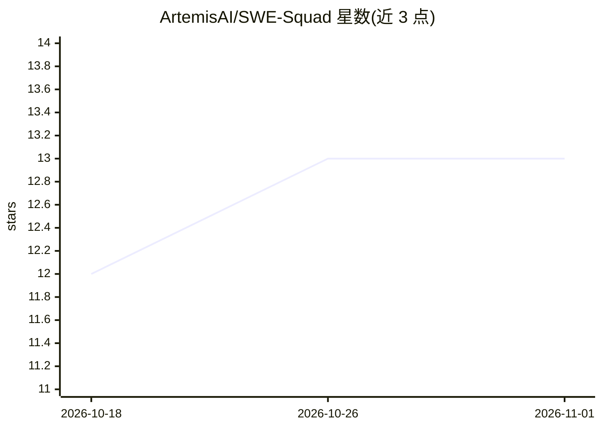

# ArtemisAI/SWE-Squad

⭐ 13 · Python · MIT · 推送 2026-05-16 · [GitHub](https://github.com/ArtemisAI/SWE-Squad) · [官网](https://github.com/ArtemisAI/SWE-Squad) · 组织维护

**常驻 AI 工程管理守护进程：自动修复 GitHub issue 并走完 PR 流程**

以持久 LLM 会话（pi-agent SDK）为核心的自主软件工程代理系统，TypeScript 控制面 + Python 代理库双层结构。功能链路：导入 GitHub issue 为票据、按严重度分诊、委派编码引擎调查根因、在 git worktree 分支上开发修复并跑测试、结构化审查 PR、合并与回归监控，关键事件经 Telegram 通知。编码引擎可配置（Claude Code CLI、Gemini CLI、OpenCode、Copilot），外部服务均为插件接口。内置熔断器、稳定门、预算控制等安全机制，附 React WebUI。需 Node.js 20+、Python 3.10+、Claude Code CLI、GitHub CLI 与 Supabase。

## 筛选速览

| 维度 | 判定 | 备注 |
|---|---|---|
| AI 角色 | `ai-native` | 本体是模型或模型工具 |
| 许可风险 | `permissive` | MIT |
| 部署形态 | `library` | 以包/库形式分发 |
| 模型依赖 | locked-api |  |
| 硬件要求 | — | 无带数字的原话,不猜 |
| 安装摩擦 | `low` | 无编译、无系统依赖或容器化 |
| 成熟度 | — | 结构信号不足 |

## 能力要点

- 持久 LLM 会话 + 16 个自定义工具的票据流水线（导入→分诊→调查→开发→审查→合并）
- 引擎无关委派：可切换 Claude Code CLI / Gemini CLI / OpenCode / Copilot
- 安全门机制：熔断器、稳定门、每票据最多 3 次尝试后升级人工、预算硬停
- pgvector 语义记忆：调查时注入 top-5 相似历史修复

## 适用场景

- 让 AI 团队夜间自动处理仓库 issue 并提交通过测试的 PR
- 为多个团队共用基础设施部署隔离的自动修复流水线
- 通过 WebUI 看板监控票据、PR 管道与成本

## 场景标签

`编码 Agent` `多智能体` · 领域:Agent 开发

## 证据(README 行号)

> L13:  An always-on AI engineering manager backed by a persistent LLM session with 16 custom tools.
> L27: 3. **Investigates** root causes by delegating to any configured coding engine
> L43: - **Engine-Agnostic Delegation** — swap coding engines (Claude CLI, Gemini CLI, Copilot, OpenCode) via config

## 星数曲线

2026-10-18 12 → 2026-11-01 13（+1）

---
*卡片 v1 · prompt 1.4 · 生成 2026-10-31 · 置信度 mid · 依据 README sha `a7b8d4d801b7` · [字段定义](../../DATASET.md)*
