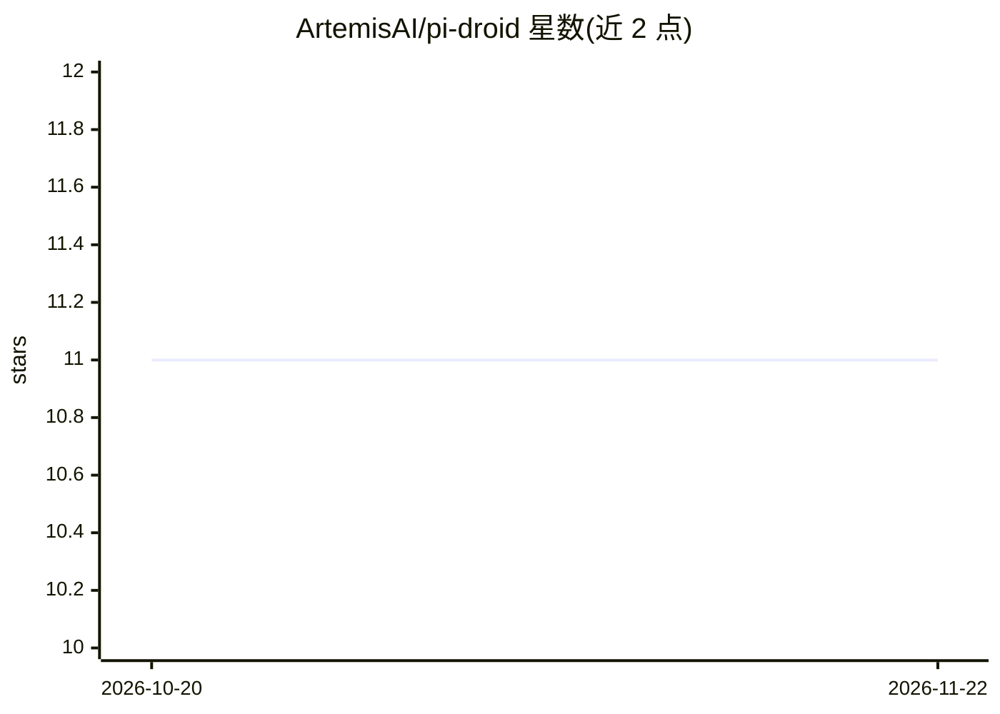

# ArtemisAI/pi-droid

⭐ 11 · TypeScript · MIT · 推送 2026-04-17 · [GitHub](https://github.com/ArtemisAI/pi-droid) · [官网](https://www.npmjs.com/package/@artemisai/pi-droid) · 组织维护

**让 AI agent 通过 ADB 控制安卓手机的 36 工具扩展**

pi-agent 的扩展包，通过 ADB 向 AI agent 提供安卓设备的实时操作能力：36 个工具分 8 类（感知/输入/导航/系统/设备管理/锁屏/录制/自动化）与 4 个 skill 组织。核心机制是带编号元素索引的标注截图，使 agent 按文本/ID/坐标点按而无需猜测像素位置。提供插件系统（含敏感操作审批门）、多设备注册、手势宏录制回放，并导出完整 ADB 层供脚本化使用。运行需 Node.js≥18、ADB、开启 USB 调试的设备；Unicode 输入需 ADBKeyboard，OCR 为可选项。

## 筛选速览

| 维度 | 判定 | 备注 |
|---|---|---|
| AI 角色 | `ai-ecosystem` | LLM/agent 周边工具 |
| 许可风险 | `permissive` | MIT |
| 部署形态 | `library` | 以包/库形式分发 |
| 模型依赖 | — | README 未给出锁定关系 |
| 硬件要求 | — | 无带数字的原话,不猜 |
| 安装摩擦 | `low` | 无编译、无系统依赖或容器化 |
| 成熟度 | — | 结构信号不足 |

## 能力要点

- 36 个工具经标注截图（编号元素索引）实现按文本/ID/坐标操作
- 4 个 skill 组织工具集，由 pi-agent 包管理器自动发现
- 插件系统支持敏感操作审批门，插件以 npm 包分发
- 导出完整 ADB 层（Device、输入、感知、自动化原语）供编程使用

## 适用场景

- 让 AI agent 代为操作安卓手机完成自动化任务
- 批量回归测试 App 界面交互流程
- 录制并回放手势宏实现重复操作自动化
- 基于导出的 ADB 层编写自定义设备控制脚本

## 场景标签

`GUI 自动化` · 领域:效率与自动化

## 证据(README 行号)

> L11: Pi-Droid is a pi-agent extension that gives AI agents direct, real-time control over Android devices via ADB. Annot
> L32: **36 tools total**, organized into 4 skills that scope tool sets for focused agent behavior.

## 星数曲线

2026-10-20 11 → 2026-11-22 11（+0）

---
*卡片 v1 · prompt 1.4 · 生成 2026-11-19 · 置信度 high · 依据 README sha `1ea8fbc6a12f` · [字段定义](../../DATASET.md)*
