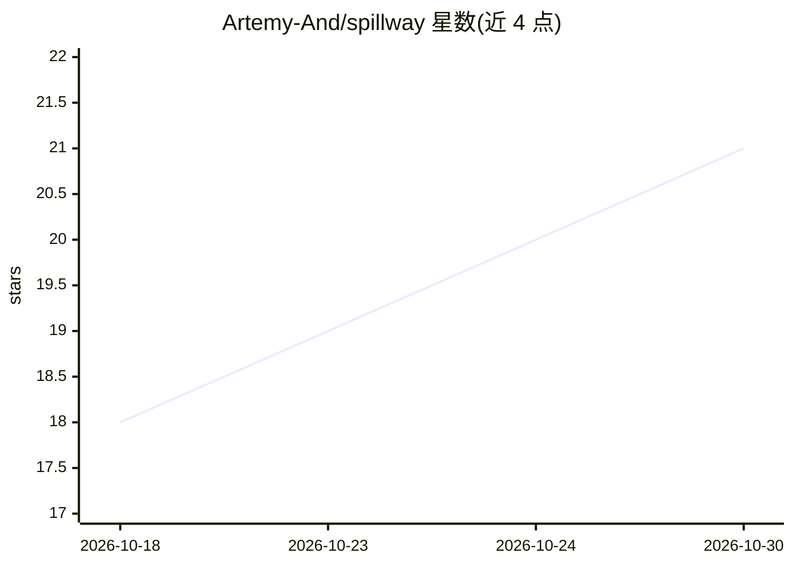

# Artemy-And/spillway

⭐ 21 · TypeScript · AGPL-3.0 · 推送 2026-10-26 · [GitHub](https://github.com/Artemy-And/spillway) · 个人维护 · 中文 README

**面向小团队的自托管 AI 网关：按人配额、超支转本地模型、PII 脱敏与免费 SSO**

单容器自托管 LLM 网关，内含管理 UI 与 SQLite。为每个人、设备、agent 发独立 key，设日/月预算与模型白名单；预算超支或云端故障时按路由规则转投本地模型（如经 Ollama 运行的 Qwen）而非直接拒绝。入站支持 OpenAI、Anthropic、Ollama 三种 API 格式并在其间互译（含流式与工具调用），上游支持 OpenAI、Anthropic、Ollama 及 Azure OpenAI、Gemini、Mistral、Groq、DeepSeek、xAI、OpenRouter 或任意 OpenAI 兼容 API。日志默认脱敏存储 PII，提供 SSO（Google/Entra ID/OIDC）、Slack/Teams/邮件告警、响应缓存与 runaway key 自动刹车。核心功能在 AGPL-3.0 下免费，通过 Docker 镜像分发（amd64/arm64），无需本地构建。

## 筛选速览

| 维度 | 判定 | 备注 |
|---|---|---|
| AI 角色 | `ai-ecosystem` | LLM/agent 周边工具 |
| 许可风险 | `viral` | AGPL-3.0 |
| 部署形态 | `desktop` | 安装包/桌面程序 |
| 模型依赖 | local-ok | 支持本地模型 |
| 硬件要求 | — | 无带数字的原话,不猜 |
| 安装摩擦 | `low` | 无编译、无系统依赖或容器化 |
| 成熟度 | — | 结构信号不足 |

## 能力要点

- 三种入站 API 格式（OpenAI/Anthropic/Ollama）互译，含流式与工具调用
- 按人/设备/agent 的 key、日/月预算、超支自动转本地模型而非阻断
- 五类路由规则：PII（卡号/IBAN/证件号等）禁止上云、限速、闲时走本地、runaway key 刹车等
- 免费 SSO（Google Workspace/Microsoft Entra ID/任意 OIDC）与脱敏日志
- 发布镜像经 Sigstore 签名并携带 SBOM 与构建溯源

## 适用场景

- 没有专职 DevOps 的小团队自建统一的 LLM 访问出口
- 给 Claude Code、Codex、n8n 等客户端每人配 key 并限制花费
- 预算耗尽或云服务商故障时自动降级到本地模型继续工作
- 防止卡号、证件号等个人数据被发送到云端模型

## 场景标签

`模型网关` · 领域:Agent 开发

## 证据(README 行号)

> L9: A self-hosted AI gateway for companies without a DevOps team. Give every person, device and agent its
> L38: - **Three API formats in, any provider out.** Clients speak OpenAI (`/v1/chat/completions`,
> L41:  calls, so Claude Code and Codex can run on a local Qwen when the budget runs out. Providers:

## 星数曲线

2026-10-18 18 → 2026-10-30 21（+3）

---
*卡片 v1 · prompt 1.4 · 生成 2026-10-28 · 置信度 mid · 依据 README sha `27ffc3b3742e` · [字段定义](../../DATASET.md)*
