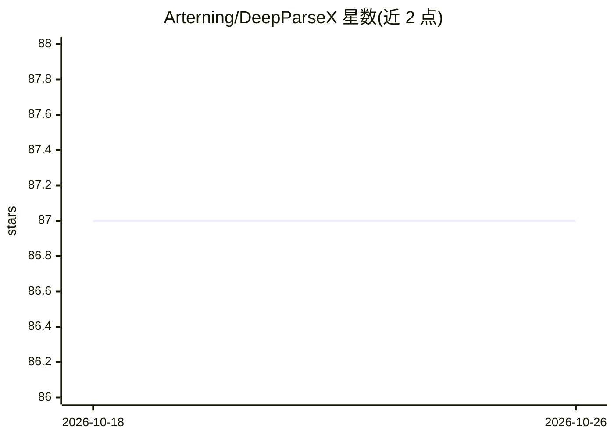

# Arterning/DeepParseX

⭐ 87 · Python · MIT · 推送 2026-08-19 · [GitHub](https://github.com/Arterning/DeepParseX) · [官网](https://dpx-landing.netlify.app/) · 个人维护 · 中文 README

**多模态文档解析平台：解析多格式文件并构建 RAG 与知识图谱**

面向企业与科研用户的文档解析与知识管理平台，支持 PDF、Word、Excel、PPT、图片、视频、音频等格式的解析，集成外部 OCR、ASR、NLP 处理非结构化数据。基于大模型提示词工程抽取实体、关系与摘要，支持自定义 Schema；使用 ParadeDB 向量数据库实现语义搜索，结合 LLM 提供问答；通过 NetworkX 构建与分析知识图谱。提供 REST API 与 Python SDK，前端为单独仓库。README 未给出具体安装命令。

## 筛选速览

| 维度 | 判定 | 备注 |
|---|---|---|
| AI 角色 | `ai-native` | 本体是模型或模型工具 |
| 许可风险 | `permissive` | MIT |
| 部署形态 | `None` |  |
| 模型依赖 | — | README 未给出锁定关系 |
| 硬件要求 | — | 无带数字的原话,不猜 |
| 安装摩擦 | `low` | 无编译、无系统依赖或容器化 |
| 成熟度 | — | 结构信号不足 |

## 能力要点

- 多模态文件解析：文本、表格、图像、语音、视频内容提取
- 基于大模型提示词工程的关键信息提取，支持自定义 Schema
- ParadeDB 向量语义搜索与 NetworkX 知识图谱构建
- 提供 REST API 与 Python SDK，支持自定义解析器、嵌入模型、LLM

## 适用场景

- 企业知识管理：自动整理合同、报告、邮件等文档
- 基于文档构建智能问答系统
- 从非结构化数据中提取结构化信息做数据分析
- 学术研究中的文献综述与知识发现

## 场景标签

`文档解析` `RAG` `知识图谱` · 领域:知识与检索

## 证据(README 行号)

> L4: **DeepParseX** 是一个强大的多模态文档解析与知识管理平台，支持 **PDF、Word、Excel、PPT、图片、视频、音频** 等多种文件格式的智能解析，自动提取关键信息，并构建 **检索增强生成（RAG）** 和 *
> L17: ✅ **检索增强生成（RAG）**
> L19: - 结合 **LLM（GPT、Llama、Claude）** 提供智能问答

## 星数曲线

2026-10-18 87 → 2026-10-26 87（+0）

---
*卡片 v1 · prompt 1.4 · 生成 2026-10-24 · 置信度 mid · 依据 README sha `ef805ef77f90` · [字段定义](../../DATASET.md)*
