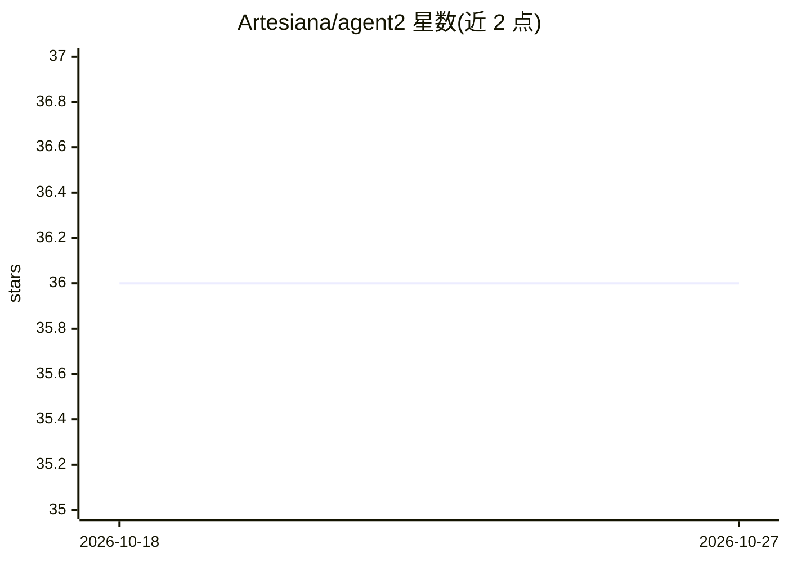

# Artesiana/agent2

⭐ 36 · Python · MIT · 推送 2026-05-06 · [GitHub](https://github.com/Artesiana/agent2) · [官网](https://getagent2.dev) · 组织维护

**把领域专家知识转化为生产级 AI agent 服务的框架**

面向企业的 agent 框架：通过 CLI onboarding（Brain Clone 访谈）从领域专家知识生成 AgentSpec，再用确定性 Python 模板生成带认证、类型化输出、异步队列、暂停恢复、人工审批、provider 路由与 mock 模式的 FastAPI HTTP 服务。运行时基于 PydanticAI，LLM 经 OpenRouter 接入（一个 key 调用 Claude/Gemini/GPT/Llama），知识检索用 R2R + FastMCP，观测用 Langfuse，默认/完整栈均以 docker compose 启动。源于 Artesiana 为德国税务公司处理数百万文档的生产实践，当前 v0.4.0，另附 5 个 SKILL.md 技能供 AI 编码工具使用。

## 筛选速览

| 维度 | 判定 | 备注 |
|---|---|---|
| AI 角色 | `ai-ecosystem` | LLM/agent 周边工具 |
| 许可风险 | `permissive` | MIT |
| 部署形态 | `self-host` | docker 或自建部署 |
| 模型依赖 | locked-api |  |
| 硬件要求 | — | 无带数字的原话,不猜 |
| 安装摩擦 | `low` | 无编译、无系统依赖或容器化 |
| 成熟度 | — | 结构信号不足 |

## 能力要点

- CLI 访谈生成 AgentSpec，模板确定性写出生产 HTTP API（认证/限流/异步/审批）
- Pydantic 类型化输出，校验失败自动重试；mock 模式无需 LLM key
- 知识检索（R2R + FastMCP）、Langfuse 观测、provider 缓存感知路由
- 内置 5 个 SKILL.md 技能，供 Claude Code/Codex/Gemini CLI 等编码工具调用

## 适用场景

- 把会计、律师、合规等专家经验固化为可调用的 API agent
- 为发票处理等文档流程生成带人工审批的自动服务
- 在自有基础设施上部署单 agent 生产端点并按需扩展编排

## 场景标签

`Agent 框架` · 领域:Agent 开发

## 证据(README 行号)

> L130: That's it. Your agent now has a production HTTP API with auth, rate limiting, structured output, async execution, 
> L137: |**PydanticAI alone**|Agent loop, structured output, tool calls|The production runtime: HTTP API, auth, async queu

## 星数曲线

2026-10-18 36 → 2026-10-27 36（+0）

---
*卡片 v1 · prompt 1.4 · 生成 2026-10-25 · 置信度 high · 依据 README sha `f3eb452fa639` · [字段定义](../../DATASET.md)*
