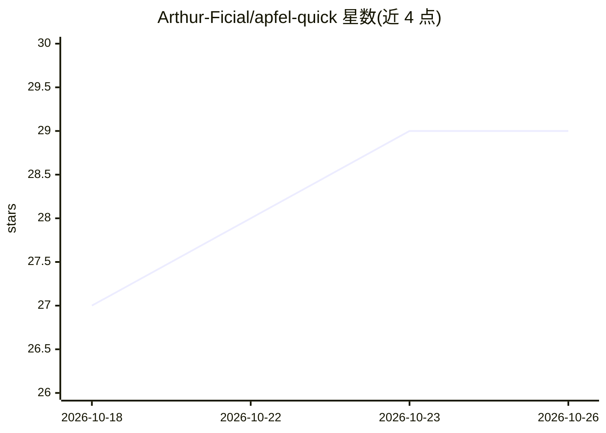

# Arthur-Ficial/apfel-quick

⭐ 29 · Swift · MIT · 推送 2026-06-14 · [GitHub](https://github.com/Arthur-Ficial/apfel-quick) · [官网](https://apfel-quick.franzai.com) · 个人维护

**macOS 本地 AI 快捷浮窗：热键唤起提问，结果进剪贴板**

Spotlight 风格的 macOS 浮窗应用，面向终端用户：全局热键唤起，输入 prompt 后由本地 apfel 服务器（`apfel --serve`，OpenAI 兼容 /v1/chat/completions）以 SSE 流式返回回答，结束后自动复制到剪贴板。纯数学表达式由内置递归下降解析器本地求值，不调用模型。全程离线，无账号、无 API key、无遥测。要求 macOS 26+ 与 Apple Silicon，并启用系统 on-device AI/Foundation Models；提供 Homebrew cask、ZIP 下载与源码构建三种安装方式。

## 筛选速览

| 维度 | 判定 | 备注 |
|---|---|---|
| AI 角色 | `ai-native` | 本体是模型或模型工具 |
| 许可风险 | `permissive` | MIT |
| 部署形态 | `desktop` | 安装包/桌面程序 |
| 模型依赖 | — | README 未给出锁定关系 |
| 硬件要求 | — | 无带数字的原话,不猜 |
| 安装摩擦 | `medium` | 含编译或系统依赖之一 |
| 成熟度 | — | 结构信号不足 |

## 能力要点

- 全局热键浮窗，回答流式返回并自动复制到剪贴板
- 纯数学表达式本地求值，不经 AI
- 完全离线运行，无账号/API key/遥测
- 源码构建之外无外部依赖，附 168 个测试

## 适用场景

- 不离开当前应用快速向 AI 提问并粘贴结果
- 本地即时计算数学表达式
- 在无网络环境下使用私有 AI 助手

## 场景标签

`AI 助手` · 领域:对话与助手

## 证据(README 行号)

> L5: A Spotlight-style overlay powered entirely by on-device AI. Hit `Ctrl+Space`, type a prompt, press `Return` — the an
> L26: - **Press Return** — the answer streams in token by token from your local Foundation Models
> L137: 5. **If no:** the prompt is sent to the local `apfel --serve` HTTP server via `/v1/chat/completions`. Tokens strea

## 星数曲线

2026-10-18 27 → 2026-10-26 29（+2）

---
*卡片 v1 · prompt 1.4 · 生成 2026-10-26 · 置信度 high · 依据 README sha `9280a2314ef9` · [字段定义](../../DATASET.md)*
