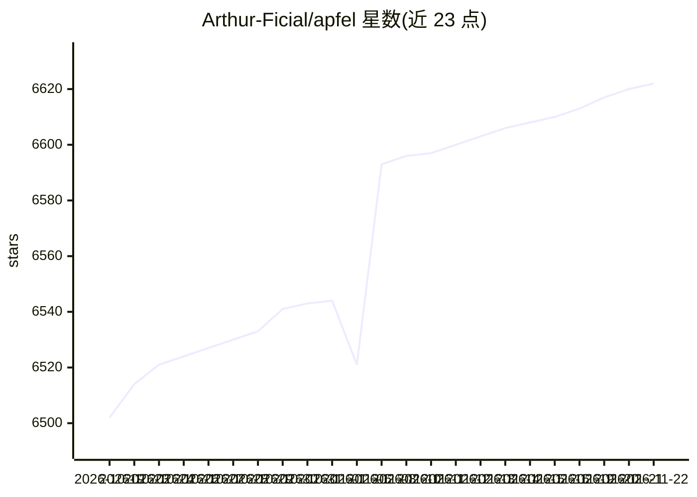

# Arthur-Ficial/apfel

⭐ 6,622 · Swift · MIT · 推送 2026-11-20 · [GitHub](https://github.com/Arthur-Ficial/apfel) · [官网](https://apfel.franzai.com) · 个人维护

**把 Apple 设备端模型封装成 CLI 与 OpenAI 兼容本地服务器**

apfel 通过 Apple FoundationModels 调用 Apple Silicon Mac 内置的大模型，以三种形态暴露：UNIX 风格 CLI（支持管道、文件附件、JSON 输出、退出码）、OpenAI 兼容本地服务器（http://localhost:11434/v1，供 OpenAI SDK 直接接入）、交互式 REPL。支持 tool calling 与 MCP 服务器（本地与远程 Streamable HTTP）。100% 设备端运行，无需 API key 与云服务。限制：仅支持 macOS 26+ 与 M1+ 芯片，上下文窗口 4096/8192 tokens，不提供 embeddings。

## 筛选速览

| 维度 | 判定 | 备注 |
|---|---|---|
| AI 角色 | `ai-ecosystem` | LLM/agent 周边工具 |
| 许可风险 | `permissive` | MIT |
| 部署形态 | `None` |  |
| 模型依赖 | — | README 未给出锁定关系 |
| 硬件要求 | — | 无带数字的原话,不猜 |
| 安装摩擦 | `medium` | 含编译或系统依赖之一 |
| 成熟度 | — | 结构信号不足 |

## 能力要点

- 提供 OpenAI 兼容的本地服务器端点，OpenAI SDK 可直接接入
- 支持 MCP 协议挂载本地与远程工具服务器
- CLI/服务器/REPL 三种模式共享同一工具调用能力
- 100% 设备端推理，无需 API key 与网络

## 适用场景

- 在 Apple Silicon Mac 上通过命令行管道处理文本生成任务
- 为现有 OpenAI SDK 应用提供本地设备端推理后端
- 通过 MCP 协议让设备端模型调用自定义工具
- 编写包装 apfel 的 shell 脚本实现英文转命令等任务

## 场景标签

 · 领域:LLM 推理运行时/开发者工具

## 证据(README 行号)

> L14: Apple Silicon Macs ship a built-in LLM via Apple FoundationModels. `apfel` exposes it as a UNIX tool and a local Op
> L19: |OpenAI-compatible server|`apfel --serve`|Drop-in local `http://localhost:11434/v1` backend for OpenAI SDKs|
> L31: macOS 26 Tahoe+, Apple Silicon (M1+), Apple Intelligence enabled. On macOS 27, Macs with an M3 or newer chip and 12

## 星数曲线

2026-10-19 6,502 → 2026-11-22 6,622（+120）

---
*卡片 v1 · prompt 1.4 · 生成 2026-11-22 · 置信度 high · 依据 README sha `4c0e65d0ed1b` · [字段定义](../../DATASET.md)*
