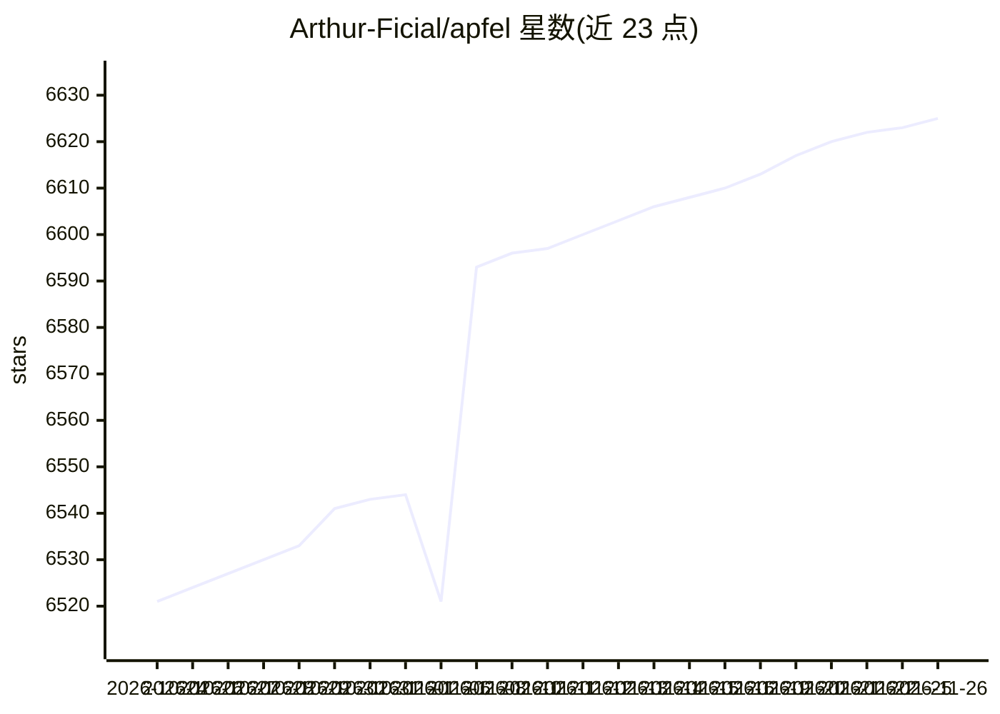

# Arthur-Ficial/apfel

⭐ 6,625 · Swift · MIT · 推送 2026-11-24 · [GitHub](https://github.com/Arthur-Ficial/apfel) · [官网](https://apfel.franzai.com) · 个人维护

**把 Mac 内置 Apple 模型暴露为 CLI 与 OpenAI 兼容本地服务器**

调用 Apple Silicon 自带的 FoundationModels 端上模型，提供三种使用形态：UNIX 管道工具（apfel "prompt"）、OpenAI 兼容本地服务器（--serve，/v1/chat/completions、/v1/responses 等）、交互式 REPL（--chat）。支持工具调用、MCP 服务器挂载（本地与远程 Streamable HTTP）、JSON schema 约束输出、流式 SSE、Token 计量。无 API key、无云端调用；限制包括 4096/8192 Token 上下文窗口、无 embeddings、无 legacy completions。需 macOS 26 Tahoe+ 与 Apple Intelligence 开启。

## 筛选速览

| 维度 | 判定 | 备注 |
|---|---|---|
| AI 角色 | `ai-ecosystem` | LLM/agent 周边工具 |
| 许可风险 | `permissive` | MIT |
| 部署形态 | `None` |  |
| 模型依赖 | — | README 未给出锁定关系 |
| 硬件要求 | — | 无带数字的原话,不猜 |
| 安装摩擦 | `medium` | 含编译或系统依赖之一 |
| 成熟度 | — | 结构信号不足 |

## 能力要点

- OpenAI 兼容服务器，端点 http://localhost:11434/v1，支持流式与 /v1/responses
- MCP 工具支持：本地脚本与远程服务器（Streamable HTTP，bearer token）
- json_schema 约束输出经 FoundationModels DynamicGenerationSchema 保证合规
- 全部端上运行，无 API key、无云、无下载

## 适用场景

- 把 OpenAI SDK 指向本地端上模型做脚本与管道处理
- 为现有 OpenAI 客户端提供无需云端的本地后端
- 通过 --mcp 在命令行调用自定义工具完成计算/查询
- 端上测试 prompt 与 MCP 服务器的 REPL

## 场景标签

`推理引擎` · 领域:训练与推理

## 证据(README 行号)

> L14: Apple Silicon Macs ship a built-in LLM via Apple FoundationModels. `apfel` exposes it as a UNIX tool and a local Op
> L19: |OpenAI-compatible server|`apfel --serve`|Drop-in local `http://localhost:11434/v1` backend for OpenAI SDKs|

## 星数曲线

2026-10-24 6,521 → 2026-11-26 6,625（+104）

---
*卡片 v1 · prompt 1.4 · 生成 2026-11-26 · 置信度 high · 依据 README sha `9c239f4d1060` · [字段定义](../../DATASET.md)*
