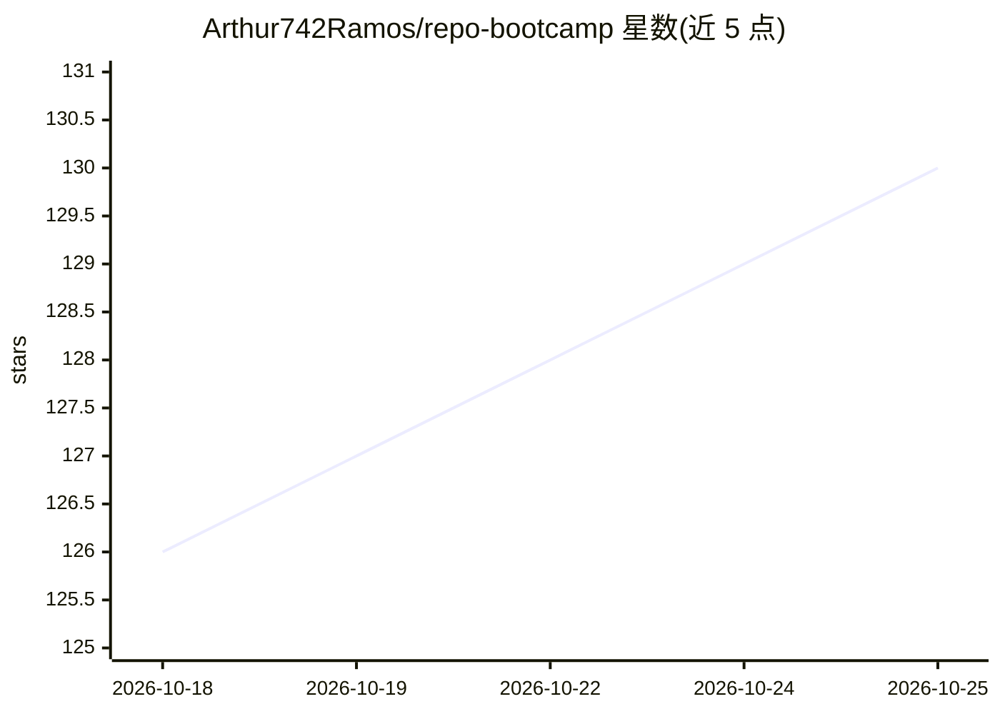

# Arthur742Ramos/repo-bootcamp

⭐ 130 · TypeScript · MIT · 推送 2026-10-19 · [GitHub](https://github.com/Arthur742Ramos/repo-bootcamp) · 个人维护

**用 GitHub Copilot SDK 把任意仓库生成 Day 1 入职文档的 CLI**

面向新加入项目的开发者的 TypeScript CLI 工具：输入 GitHub/GitLab/Bitbucket 仓库 URL，通过 Copilot SDK 的 agentic AI（Claude 多轮探索、工具调用、Zod 校验加自动重试）在约 60 秒内生成 14+ 份互联 markdown 文档（BOOTCAMP/ARCHITECTURE/FIRST_TASKS/HEALTH 等）。附 22 命令 CLI：交互式问答、健康与安全评分、耦合图、循环依赖检测、任务发现、Web UI 等。支持 10+ 种语言的仓库。限制：生成时间随仓库/模型变化，未做新基准测试。

## 筛选速览

| 维度 | 判定 | 备注 |
|---|---|---|
| AI 角色 | `ai-native` | 本体是模型或模型工具 |
| 许可风险 | `permissive` | MIT |
| 部署形态 | `library` | 以包/库形式分发 |
| 模型依赖 | — | README 未给出锁定关系 |
| 硬件要求 | — | 无带数字的原话,不猜 |
| 安装摩擦 | `low` | 无编译、无系统依赖或容器化 |
| 成熟度 | — | 结构信号不足 |

## 能力要点

- Copilot SDK agentic 分析：agent 自主读取文件、搜索代码并理解架构
- 生成 14+ 份互联 markdown 文档（概览/架构/首批任务/健康评分等）
- 22 命令 CLI：交互问答、scan 仪表盘、coupling/cycles/preflight/owners/tasks 等
- Zod 模式校验 LLM 输出并自动重试；模型自动降级 claude-opus-4-5 → claude-sonnet-4-5

## 适用场景

- 新加入项目时快速生成一套入门文档与首批任务清单
- 对存量仓库做健康度、耦合与技术雷达分析
- 用自然语言向代码库提问（交互式 Q&A 模式）

## 场景标签

`代码审查` · 领域:编码与开发

## 证据(README 行号)

> L50: **Repo Bootcamp** uses agentic AI to analyze repositories from GitHub, GitLab, or Bitbucket and generate comprehens
> L84: 1. **Powered by GitHub Copilot SDK** - Leverages the official SDK for agentic AI with tool-calling
> L156: - **Agentic Analysis** - Claude autonomously reads files, searches code, and understands architecture

## 星数曲线

2026-10-18 126 → 2026-10-25 130（+4）

---
*卡片 v1 · prompt 1.4 · 生成 2026-10-23 · 置信度 high · 依据 README sha `e4ea3a5fa164` · [字段定义](../../DATASET.md)*
