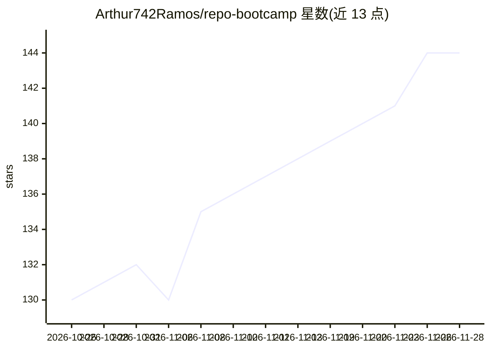

# Arthur742Ramos/repo-bootcamp

⭐ 144 · TypeScript · MIT · 推送 2026-11-16 · [GitHub](https://github.com/Arthur742Ramos/repo-bootcamp) · 个人维护

**用 Copilot SDK 为代码仓库生成新人入职文档套件的 CLI**

Repo Bootcamp 是一个 TypeScript CLI 工具：输入 GitHub/GitLab/Bitbucket 仓库 URL，通过 GitHub Copilot SDK 驱动的 agent（工具调用、多轮对话、流式输出）自主读取与检索代码文件，生成 14+ 份互联的 Markdown 文档（BOOTCAMP/ARCHITECTURE/CODEMAP/FIRST_TASKS 等），并附带 22 个子命令，覆盖 Q&A 问答、健康/指标评分、耦合图、循环依赖检测、任务发现与 Web UI。输出经 Zod schema 校验并自动重试。要求 Node.js >= 24，以 npm 包形式发布，MIT 许可。

## 筛选速览

| 维度 | 判定 | 备注 |
|---|---|---|
| AI 角色 | `ai-native` | 本体是模型或模型工具 |
| 许可风险 | `permissive` | MIT |
| 部署形态 | `library` | 以包/库形式分发 |
| 模型依赖 | — | README 未给出锁定关系 |
| 硬件要求 | — | 无带数字的原话,不猜 |
| 安装摩擦 | `low` | 无编译、无系统依赖或容器化 |
| 成熟度 | — | 结构信号不足 |

## 能力要点

- 通过 GitHub Copilot SDK 的 agent 工具调用自主探索代码库
- 生成 14+ 份互联 Markdown 入职文档，含 Mermaid 图
- 22 命令 CLI：Q&A、扫描面板、耦合图、循环依赖检测等
- LLM 输出经 Zod schema 校验并自动重试

## 适用场景

- 新成员加入项目时快速获得架构与上手文档
- 为没有维护文档的开源仓库生成入门材料
- 用交互式 Q&A 模式用自然语言询问代码库
- 检查现有文档是否与代码漂移并自动修复

## 场景标签

`AI 写作` · 领域:内容生成

## 证据(README 行号)

> L50: **Repo Bootcamp** uses agentic AI to analyze repositories from GitHub, GitLab, or Bitbucket and generate comprehens
> L86: 1. **Powered by GitHub Copilot SDK** - Leverages the official SDK for agentic AI with tool-calling
> L90: 5. **Full Feature Set** - A 22-command CLI: interactive Q&A, a combined scan dashboard, health/metrics/security sco

## 星数曲线

2026-10-26 130 → 2026-11-28 144（+14）

---
*卡片 v1 · prompt 1.4 · 生成 2026-11-27 · 置信度 high · 依据 README sha `79e14ff17baf` · [字段定义](../../DATASET.md)*
