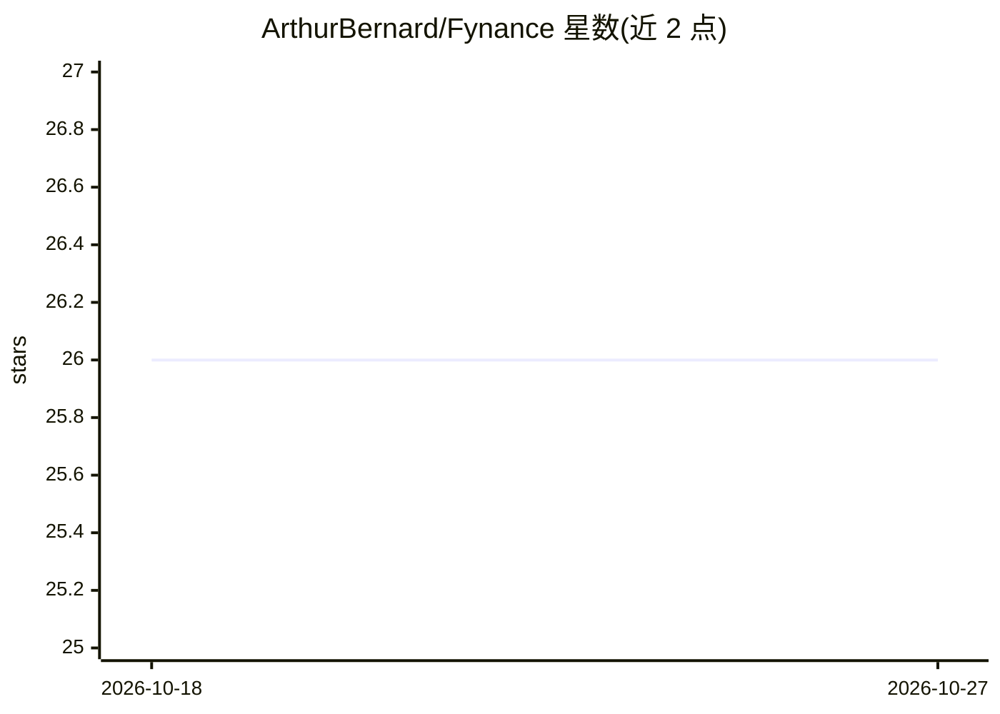

# ArthurBernard/Fynance

⭐ 26 · Python · MIT · 推送 2026-07-13 · [GitHub](https://github.com/ArthurBernard/Fynance) · 个人维护

**面向金融回测的机器学习/计量经济学 Python 工具库**

纯 Python 包（Numba 加速内核），提供数据→特征→信号→组合→回测→度量的分层式量化研究工具链：CSV/Parquet 数据加载与无前视时间切分、技术指标与 AFML 标注、绩效与尾部风险度量、ERC/HRP 等配置方法、向量化回测引擎与成本模型，以及 ARMA-GARCH 和 PyTorch 神经网络模型、实验记录与过拟合防护。各组件可独立使用，Strategy 为可选编排器。2.0 为破坏性版本。面向量化研究与策略回测的开发者。

## 筛选速览

| 维度 | 判定 | 备注 |
|---|---|---|
| AI 角色 | `ai-native` | 本体是模型或模型工具 |
| 许可风险 | `permissive` | MIT |
| 部署形态 | `library` | 以包/库形式分发 |
| 模型依赖 | — | README 未给出锁定关系 |
| 硬件要求 | — | 无带数字的原话,不猜 |
| 安装摩擦 | `low` | 无编译、无系统依赖或容器化 |
| 成熟度 | — | 结构信号不足 |

## 能力要点

- 数据→特征→信号→组合→回测→度量的分层架构，各组件可独立使用
- 无前视切分、purged CV、deflated Sharpe/PBO 等过拟合防护
- ARMA-GARCH 计量模型与 PyTorch 网络（MLP/LSTM/Transformer/RegimeMoE 等）
- 纯 Python 构建，数值内核由 Numba JIT 编译，无需编译步骤

## 适用场景

- 我想回测交易策略并计算 Sharpe、回撤等绩效指标
- 我想做金融特征工程与市场状态检测
- 我想训练并评估用于收益预测的神经网络模型
- 我想做带交易成本与容量分析的组合配置实验

## 场景标签

`金融量化` · 领域:学习与行业

## 证据(README 行号)

> L15: Pure-Python package (Numba-accelerated kernels) providing **machine learning**,
> L94: **Models** `fynance.models` — econometric models (MA, ARMA, ARMA-GARCH, plus

## 星数曲线

2026-10-18 26 → 2026-10-27 26（+0）

---
*卡片 v1 · prompt 1.4 · 生成 2026-10-26 · 置信度 high · 依据 README sha `601b13c5925a` · [字段定义](../../DATASET.md)*
