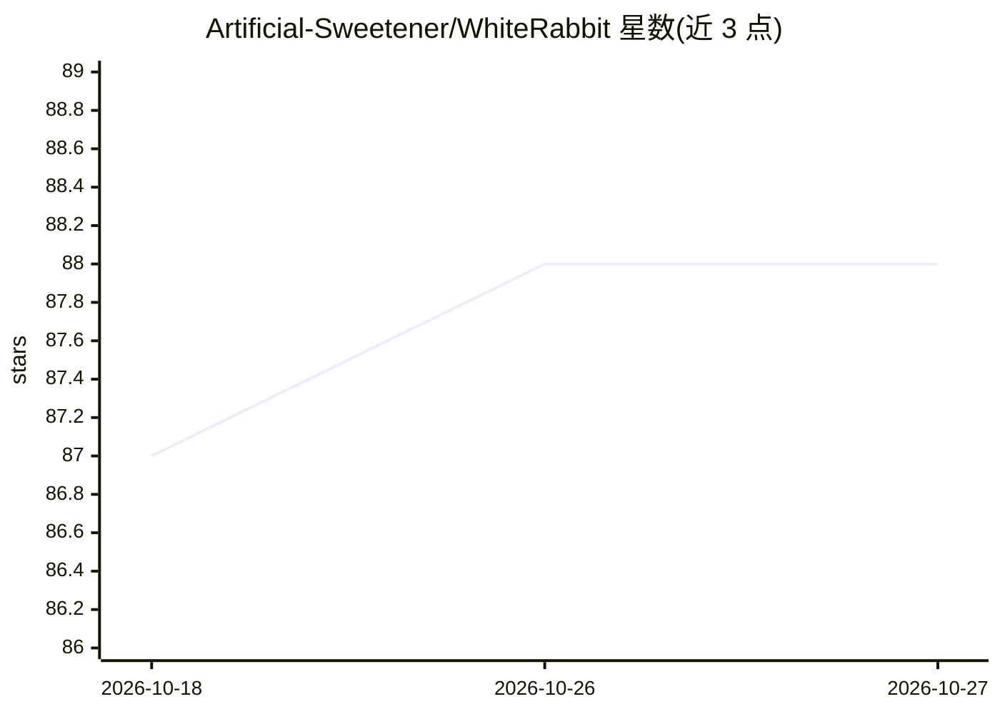

# Artificial-Sweetener/WhiteRabbit

⭐ 88 · Python · AGPL-3.0 · 推送 2026-07-28 · [GitHub](https://github.com/Artificial-Sweetener/WhiteRabbit) · [官网](https://artificialsweeter.ai) · 个人维护 · 中文 README

**给 ComfyUI 用户的视频帧处理节点包：补帧、变速、无缝循环与批量缩放**

为 ComfyUI 提供的视频帧操作节点包（nodepack），核心功能基于 RIFE 4.7/4.9/4.25/4.26 的帧插值：倍数补帧、任意目标帧率重采样、自定义时间点插帧与无缝循环接缝计时分析；另含循环制作工具组（准备/拼装循环帧、自动裁剪、帧滚动）与后处理节点（CUDA 加速的 Lanczos 批量缩放、模型放大、Pixel Hold 降噪闪、批量水印）。所有节点面向批量处理设计。安装方式为将文件夹放入 custom_nodes 并用 ComfyUI Python 环境安装 torchlanc 依赖，RIFE 模型缺失时自动下载并做 SHA-256 校验。

## 筛选速览

| 维度 | 判定 | 备注 |
|---|---|---|
| AI 角色 | `ai-native` | 本体是模型或模型工具 |
| 许可风险 | `viral` | AGPL-3.0 |
| 部署形态 | `library` | 以包/库形式分发 |
| 模型依赖 | — | README 未给出锁定关系 |
| 硬件要求 | — | 无带数字的原话,不猜 |
| 安装摩擦 | `medium` | 含编译或系统依赖之一 |
| 成熟度 | — | 结构信号不足 |

## 能力要点

- 基于 RIFE 的帧插值节点：倍数补帧、任意 FPS 重采样、自定义时间点插帧
- 无缝循环工具链：Prepare/Assemble Loop Frames、接缝计时分析、自动裁剪
- CUDA 加速 Lanczos 批量缩放（TorchLanc）
- RIFE 模型缺失时自动下载并以 SHA-256 校验

## 适用场景

- 在 ComfyUI 工作流中为视频补帧或转换帧率
- 制作无缝循环视频（如动态壁纸、生成式视频片段）
- 批量缩放、水印合成与视频去闪烁等后处理

## 场景标签

`图像视频处理` · 领域:感知与多模态

## 证据(README 行号)

> L6: This is **WhiteRabbit**, a nodepack designed to help you work with video from within ComfyUI.
> L41: These nodes bend time itself to add or remove frames with **RIFE 4.7, 4.9,
> L112: This node pack uses **RIFE (IFNet)** for video frame interpolation. You can read the white paper here.

## 星数曲线

2026-10-18 87 → 2026-10-27 88（+1）

---
*卡片 v1 · prompt 1.4 · 生成 2026-10-23 · 置信度 mid · 依据 README sha `38030e79d900` · [字段定义](../../DATASET.md)*
