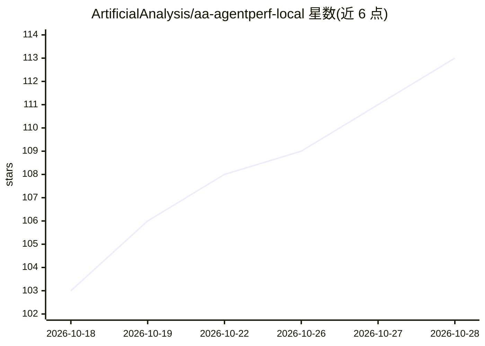

# ArtificialAnalysis/aa-agentperf-local

⭐ 114 · Python · Apache-2.0 · 推送 2026-10-16 · [GitHub](https://github.com/ArtificialAnalysis/aa-agentperf-local) · [官网](https://artificialanalysis.ai) · 组织维护

**本地 LLM 推理性能基准工具：回放真实 agent 轨迹测吞吐与延迟**

Artificial Analysis 开源的本地模型服务基准测试工具：将录制的 agent 对话回放至 OpenAI 兼容的模型服务器，每条请求携带此前全部对话，测量吞吐量与首 token/回合延迟，不评估输出质量。支持两类模式：对已运行的服务器测试，或由工具下载固定版本模型、启动服务器并测试。兼容 llama.cpp、vLLM、SGLang、Ollama、LM Studio 等，可选用 Docker 运行真实工具调用、Rust 客户端记录计时，并可自愿提交结果至 Artificial Analysis。

## 筛选速览

| 维度 | 判定 | 备注 |
|---|---|---|
| AI 角色 | `ai-ecosystem` | LLM/agent 周边工具 |
| 许可风险 | `permissive` | Apache-2.0 |
| 部署形态 | `None` |  |
| 模型依赖 | local-ok | 支持本地模型 |
| 硬件要求 | — | 无带数字的原话,不猜 |
| 安装摩擦 | `low` | 无编译、无系统依赖或容器化 |
| 成熟度 | `idea` | |

## 能力要点

- 回放录制的 agent 对话（默认 8 任务 168 回合）测量吞吐与延迟
- managed-run 下载固定版本模型、校验 SHA-256 并自动启停服务器
- 兼容 llama.cpp/vLLM/SGLang/Ollama/LM Studio 等 OpenAI 兼容服务器
- 提供 TUI 引导界面与可选 Rust 客户端（计时在 Python 之外）

## 适用场景

- 测量本机跑某个模型服务 agent 负载的速度
- 对比不同推理框架在本机硬件上的吞吐与延迟
- 验证部署环境（用 aa-mini-v1 六回合小回放快速检查）

## 场景标签

`模型评测` · 领域:评测与运维

## 证据(README 行号)

> L15: `agentperf-local` measures how fast your machine serves an AI agent. It replays
> L16: recorded agent conversations against an OpenAI-compatible model server and
> L31: OpenAI-compatible API, such as llama.cpp, LM Studio, vLLM, SGLang, or Ollama,

## 星数曲线

2026-10-18 103 → 2026-10-28 113（+10）

---
*卡片 v1 · prompt 1.4 · 生成 2026-10-23 · 置信度 high · 依据 README sha `72f55bf5a6ad` · [字段定义](../../DATASET.md)*
