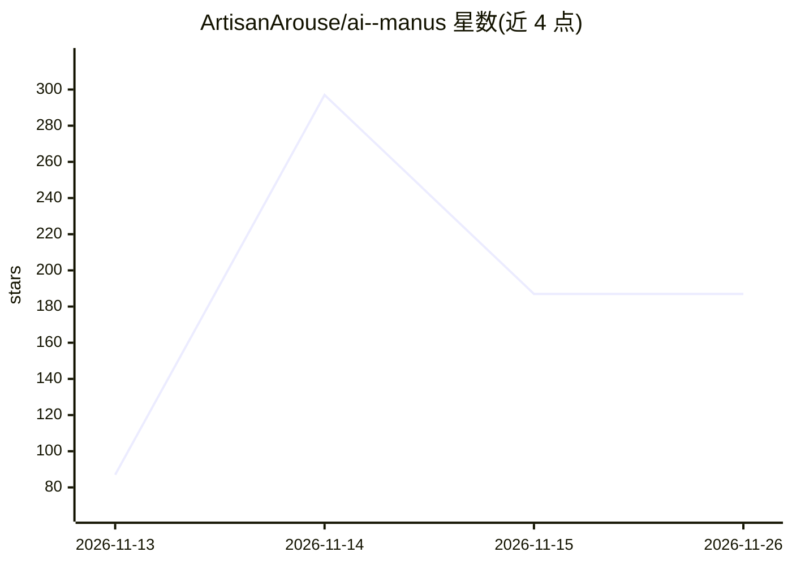

# ArtisanArouse/ai--manus

⭐ 187 · Apache-2.0 · 推送 2026-11-15 · [GitHub](https://github.com/ArtisanArouse/ai--manus) · 个人维护

**面向日常任务的自主 AI Agent，可执行代码与控制浏览器**

自述为通用自主 AI Agent 系统，在沙箱环境中运行工具与操作：代表用户编写并执行脚本、控制浏览器（导航页面、填写表单、收集信息）、执行多步任务。README 面向家庭、学习与轻量办公场景的非开发者用户，强调无需编程门槛。但 README 未给出任何具体安装命令、技术架构、模型接入方式或代码示例，仅有使用流程建议与硬件兼容性表格，可验证的技术事实有限。

## 筛选速览

| 维度 | 判定 | 备注 |
|---|---|---|
| AI 角色 | `ai-native` | 本体是模型或模型工具 |
| 许可风险 | `permissive` | Apache-2.0 |
| 部署形态 | `None` |  |
| 模型依赖 | — | README 未给出锁定关系 |
| 硬件要求 | — | 无带数字的原话,不猜 |
| 安装摩擦 | `low` | 无编译、无系统依赖或容器化 |
| 成熟度 | — | 结构信号不足 |

## 能力要点

- 自主执行代码与脚本
- 浏览器控制：导航、填表、信息收集
- 多步任务可在脚本与浏览器操作间衔接

## 适用场景

- 让代理代为完成重复的网页操作与数据收集
- 学生整理研究资料、运行小型脚本
- 轻量办公中跨多个页面汇总信息

## 场景标签

`浏览器自动化` `AI 助手` · 领域:效率与自动化

## 证据(README 行号)

> L18: Manus is an autonomous AI agent designed to run code and control a browser on your behalf. Instead of acting like a

## 星数曲线

2026-11-13 87 → 2026-11-26 187（+100）

---
*卡片 v1 · prompt 1.4 · 生成 2026-11-17 · 置信度 low · 依据 README sha `0f78ee3a5dd2` · [字段定义](../../DATASET.md)*
