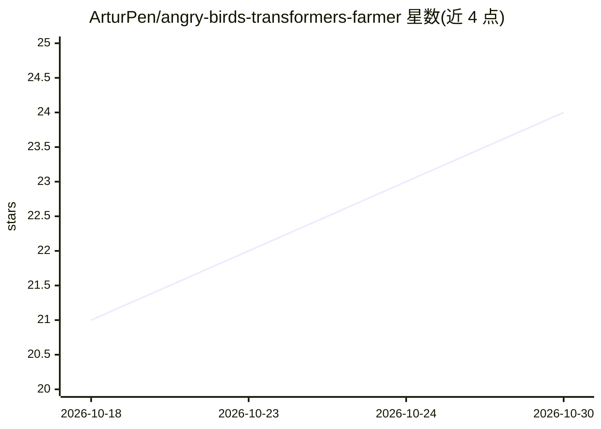

# ArturPen/angry-birds-transformers-farmer

⭐ 24 · Python · MIT · 推送 2026-05-28 · [GitHub](https://github.com/ArturPen/angry-birds-transformers-farmer) · 个人维护

**Angry Birds Transformers 时间跳跃刷资源自动化工具（需模拟器 Root）**

Python tkinter 桌面 GUI 工具，通过 ADB 连接已 Root 的 BlueStacks 5 模拟器，操纵系统时钟循环跳日以刷取《Angry Birds Transformers》的宝石与签到资源，结束后执行 Time Fix（回拨到前一日 23:59 并重启游戏）修复日历同步。仅用 Python 内置模块，无第三方库；提供源码与 Releases 中的 PyInstaller 打包 exe 两种使用方式。README 声明该工具违反游戏服务条款，账号可能被封禁；不含任何 AI 功能，主题标签中的 transformers 指游戏名。

## 筛选速览

| 维度 | 判定 | 备注 |
|---|---|---|
| AI 角色 | `ai-enhanced` | 去掉 AI 部分产品仍成立 |
| 许可风险 | `permissive` | MIT |
| 部署形态 | `desktop` | 安装包/桌面程序 |
| 模型依赖 | — | README 未给出锁定关系 |
| 硬件要求 | — | 无带数字的原话,不猜 |
| 安装摩擦 | `low` | 无编译、无系统依赖或容器化 |
| 成熟度 | — | 结构信号不足 |

## 能力要点

- 两种刷取模式：宝石（每循环跳 2 天）与周奖励资源（每循环跳 1 天）
- Time Fix 流程回拨时钟并重启游戏以修复日历
- STOP 按钮需完成最小循环数（5/14）后才解锁，防止日历损坏
- 崩溃/最小化自动停止与双通道日志（GUI 活动日志 + farm_log.txt）

## 适用场景

- 在已 Root 的模拟器上自动刷取游戏宝石与签到奖励
- 自动完成游戏时间跳跃漏洞的手动重复操作

## 场景标签

 · 领域:游戏工具/自动化

## 证据(README 行号)

> L9: A fully automated Python tool for the **Ultimate Time-Skip Glitch** in Angry Birds Transformers. Connects to a roote
> L43:  `app.py` launches a dark-themed desktop window (`ABTFarmerApp`) built with Python's built-in `tkinter` library. No

## 星数曲线

2026-10-18 21 → 2026-10-30 24（+3）

---
*卡片 v1 · prompt 1.4 · 生成 2026-10-27 · 置信度 mid · 依据 README sha `dd72ae6a23fd` · [字段定义](../../DATASET.md)*
