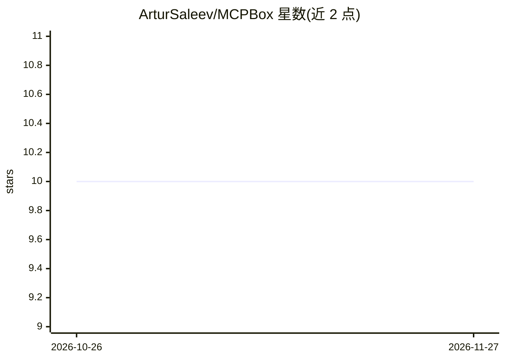

# ArturSaleev/MCPBox

⭐ 10 · Go · Apache-2.0 · 推送 2026-10-23 · [GitHub](https://github.com/ArturSaleev/MCPBox) · 个人维护

**个人/小团队本地 MCP 服务器管理中心：统一入口与权限审计**

用 Go 编写的单程序，部署在本机上为每个项目提供统一的 MCP URL，管理员通过 Web UI 决定 agent 可调用的命令、文档与 Skills，并记录每次 MCP 请求日志。面向已有多个项目、各自有数据库和代码、使用 MCP 客户端的开发者或小团队。数据存于二进制旁的本地 SQLite 数据库，不外发；Skills 脚本执行需 Docker，以非特权用户、只读根文件系统运行。声明非云服务、非企业网关、非 RAG。

## 筛选速览

| 维度 | 判定 | 备注 |
|---|---|---|
| AI 角色 | `ai-ecosystem` | LLM/agent 周边工具 |
| 许可风险 | `permissive` | Apache-2.0 |
| 部署形态 | `desktop` | 安装包/桌面程序 |
| 模型依赖 | — | README 未给出锁定关系 |
| 硬件要求 | — | 无带数字的原话,不猜 |
| 安装摩擦 | `low` | 无编译、无系统依赖或容器化 |
| 成熟度 | — | 结构信号不足 |

## 能力要点

- 每项目一个 MCP URL 与独立访问规则
- 全部 MCP 请求记录日志，服务器状态可见
- 本地全文知识检索，离线可用
- Skills 脚本经 Docker 沙箱执行（非特权用户、只读根、默认无网络）

## 适用场景

- 多个项目共用 MCP 工具时免于各客户端重复配置 JSON
- 限定 AI agent 可执行的命令与可读的文件范围
- 排查 agent 实际做了哪些调用

## 场景标签

 · 领域:LLM 基础设施/MCP 工具管理

## 证据(README 行号)

> L3: **One program on your own machine that gives every project a single MCP address — and one place to decide what an AI
> L5: I had 20 projects and 20 databases, and every AI client wanted its own JSON config with the same secrets copied into
> L46: AI client → project MCP URL → MCP servers + approved CLI operations + knowledge base + Skills

## 星数曲线

2026-10-26 10 → 2026-11-27 10（+0）

---
*卡片 v1 · prompt 1.4 · 生成 2026-11-20 · 置信度 high · 依据 README sha `a256823cafad` · [字段定义](../../DATASET.md)*
