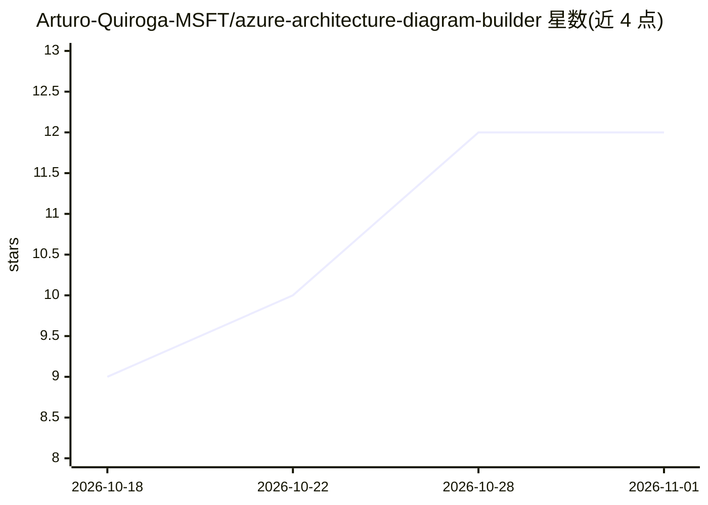

# Arturo-Quiroga-MSFT/azure-architecture-diagram-builder

⭐ 12 · TypeScript · MIT · 推送 2026-10-31 · [GitHub](https://github.com/Arturo-Quiroga-MSFT/azure-architecture-diagram-builder) · [官网](https://aka.ms/diagram-builder) · 个人维护

**AI 驱动的 Azure 架构图设计、验证与部署工具**

面向云架构师的 Web 应用：用自然语言生成带逻辑分组的 Azure 架构拓扑图与白板风格 Blueprint 图（BETA），支持 14 个 AI 模型（GPT 系、Claude、DeepSeek、Grok、Mistral、Kimi 等，经 Azure OpenAI/Anthropic/Microsoft Foundry 部署接入）并做多模型对比。提供对话式细化、语音设计助手 Ava、架构图图片导入还原、ARM 模板导入可视化、五支柱 Well-Architected Framework 校验、基于 Azure Retail Prices API 的实时成本估算，以及基于 Microsoft Learn 检索的 Bicep 部署指南生成。仅支持 Azure 服务，定位绿地新设计而非既有环境审计；含 22 个分类示例提示词。

## 筛选速览

| 维度 | 判定 | 备注 |
|---|---|---|
| AI 角色 | `ai-native` | 本体是模型或模型工具 |
| 许可风险 | `permissive` | MIT |
| 部署形态 | `self-host` | docker 或自建部署 |
| 模型依赖 | locked-api |  |
| 硬件要求 | — | 无带数字的原话,不猜 |
| 安装摩擦 | `low` | 无编译、无系统依赖或容器化 |
| 成熟度 | `idea` | |

## 能力要点

- 自然语言生成 Azure 架构图，支持 14 个 AI 模型多模型对比
- 五支柱 WAF 校验与推荐采纳后自动重生成架构
- ARM 模板导入与架构图图片 AI 还原为可编辑图
- Microsoft Learn 检索接地的 Bicep 部署指南生成与实时多区域成本估算

## 适用场景

- 用自然语言快速起草并迭代 Azure 新方案架构图
- 在架构评审中生成白板风格 Blueprint 图与部署文档
- 多模型对比同一需求下的架构产出与 WAF 得分
- 为设计研讨会与技术工作坊做加速器

## 场景标签

 · 领域:云计算/架构设计工具

## 证据(README 行号)

> L24: Azure Architecture Diagram Builder is an enterprise-grade web application that empowers cloud architects to design,
> L48: ### 🤖 AI-Powered Architecture Generation

## 星数曲线

2026-10-18 9 → 2026-11-01 12（+3）

---
*卡片 v1 · prompt 1.4 · 生成 2026-11-01 · 置信度 high · 依据 README sha `d9e45692fb87` · [字段定义](../../DATASET.md)*
