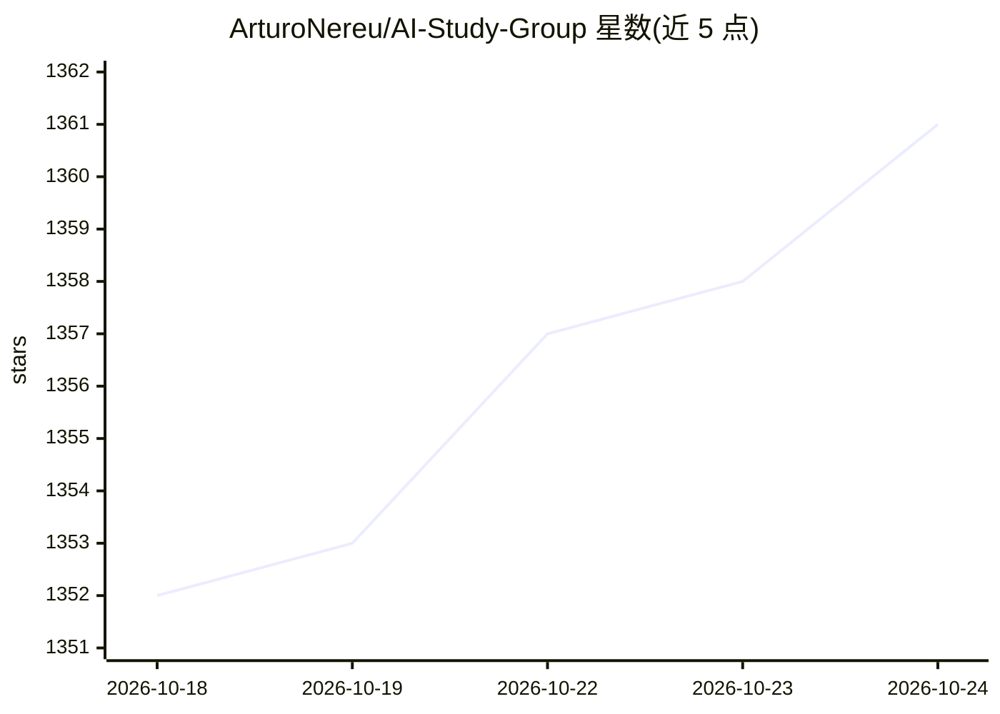

# ArturoNereu/AI-Study-Group

⭐ 1,361 · 推送 2026-10-23 · [GitHub](https://github.com/ArturoNereu/AI-Study-Group) · 个人维护

**个人 AI 学习资源清单：书籍、课程、工具、模型与数据集**

个人维护的 AI 学习资源合集，收录作者学习 AI 过程中使用的书籍、视频课程、演讲、工具框架、Python 库、模型、论文、数据集与笔记，按类别分节组织。书籍部分列出 5 本推荐，课程覆盖 NVIDIA/MIT/FastAI 等，工具部分以表格整理 Hugging Face、Ollama、Gradio 等，数据集表格收录 Kaggle、COCO、ImageNet 等来源。仓库自述为学习日志而非课程体系，不含可安装代码。

## 筛选速览

| 维度 | 判定 | 备注 |
|---|---|---|
| AI 角色 | `ai-knowledge` | 知识聚合/清单类 |
| 许可风险 | `none` | — |
| 部署形态 | `None` |  |
| 模型依赖 | — | README 未给出锁定关系 |
| 硬件要求 | — | 无带数字的原话,不猜 |
| 安装摩擦 | `low` | 无编译、无系统依赖或容器化 |
| 成熟度 | — | 结构信号不足 |

## 能力要点

- 覆盖书籍、课程、视频、工具、模型、数据集、论文等多类资源
- 工具与 Python 库按类别表格化整理
- 收录 12+ 个知名数据集及其领域标注

## 适用场景

- 寻找 AI/ML/DL 入门书籍与视频课程
- 了解常用 AI 工具、框架与 Python 库的分布
- 查找训练模型可用的公开数据集

## 场景标签

`精选清单` `教程课程` · 领域:学习与行业

## 证据(README 行号)

> L16: This repository is a collection of the material I’ve used (and continue to use) to learn AI: books, courses, papers
> L35: ## Courses & Tutorials

## 星数曲线

2026-10-18 1,352 → 2026-10-24 1,361（+9）

---
*卡片 v1 · prompt 1.4 · 生成 2026-10-21 · 置信度 high · 依据 README sha `15c91f756a45` · [字段定义](../../DATASET.md)*
