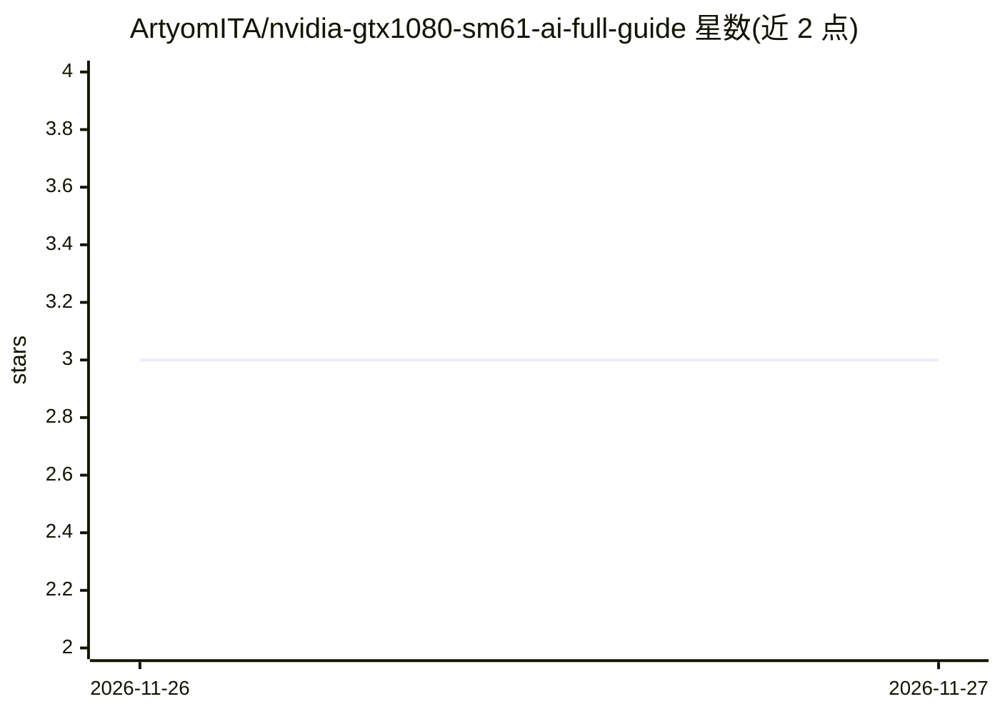

# ArtyomITA/nvidia-gtx1080-sm61-ai-full-guide

⭐ 3 · Python · NOASSERTION · 推送 2026-11-23 · [GitHub](https://github.com/ArtyomITA/nvidia-gtx1080-sm61-ai-full-guide) · [官网](https://artyomita.github.io) · 个人维护

**GTX 1080 (sm_61, 8GB) 上运行与训练 AI 模型的实测优化指南**

作者将 2016 年 Pascal 架构 GTX 1080 (sm_61) 上运行的 AI 模型优化工作汇总为按主题组织的指南：每条目记录问题、改动、测量数据与复现方式，涵盖 llama.cpp 内核、CUDA graphs、投机解码、三值模型、LoRA 训练与视频扩散等。附硬件限制表（无 tensor core、FP16 算力仅 1/64、CUDA 13 不再支持 Pascal）、测量方法论（A-B-B-A 交替、KL 散度门槛、固定种子）与 17 行完整结果表。文本 CC BY 4.0，代码片段 MIT。

## 筛选速览

| 维度 | 判定 | 备注 |
|---|---|---|
| AI 角色 | `ai-knowledge` | 知识聚合/清单类 |
| 许可风险 | `none` | NOASSERTION |
| 部署形态 | `None` |  |
| 模型依赖 | local-ok | 支持本地模型 |
| 硬件要求 | — | 无带数字的原话,不猜 |
| 安装摩擦 | `high` | 编译与系统依赖俱全 |
| 成熟度 | — | 结构信号不足 |

## 能力要点

- 按主题组织，每条目含问题、改动、测量与复现链接
- 记录 sm_61 硬件限制表：无 tensor core、依赖 dp4a int8、CUDA 12.x 为最后支持线
- A-B-B-A 测量方法、KL 散度质量门槛与固定采样种子
- 向 llama.cpp、PrismML fork、stable-diffusion.cpp 上游提交 2 个已合并 PR

## 适用场景

- 在 8 GB Pascal 显卡上复现本地 LLM 推理加速方案
- 在 8 GB 显存内做 LoRA 训练与全参数 SFT
- 为旧 GPU 上的视频扩散与语音任务寻找优化配方

## 场景标签

`教程课程` `推理引擎` `微调` `模型量化` · 领域:学习与行业

## 证据(README 行号)

> L16: Everything I measured, patched and trained to make current AI models run fast on one GeForce GTX 1080 (Pascal, comp
> L90: 1. LLM inference kernels in llama.cpp: CUDA graphs, ternary mat-vec, MiniCPM5 kernels, f16 KV cache, dead KV slots,

## 星数曲线

2026-11-26 3 → 2026-11-27 3（+0）

---
*卡片 v1 · prompt 1.4 · 生成 2026-11-26 · 置信度 high · 依据 README sha `e7c3f363214c` · [字段定义](../../DATASET.md)*
