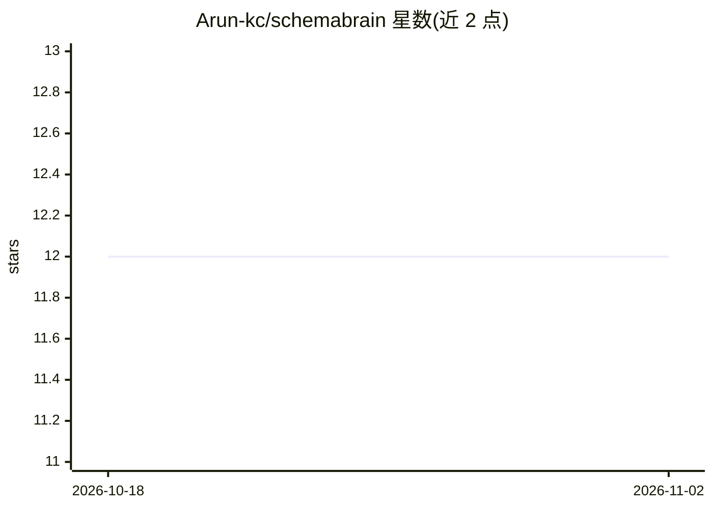

# Arun-kc/schemabrain

⭐ 12 · Python · Apache-2.0 · 推送 2026-08-24 · [GitHub](https://github.com/Arun-kc/schemabrain) · [官网](https://www.schemabrain.dev) · 个人维护

**AI agent 与数据库之间的只读信任层：MCP 语义访问+审计**

面向在数据库上运行 AI agent 的开发者的 MCP 服务器：以 12 个只读工具为 agent 提供查询接口，查询由受控的实体/指标/联接定义编译为参数化 SQL，不存在从提示到原始 SQL 的路径。PII 标签从物理模式传播到查询边界，命中封锁类别时在查询前拒绝；每次调用、拒绝与恢复写入 SHA256 哈希链的只追加审计日志，可用 audit verify 校验。配套七阶段 init 向导（接入 Claude Desktop 等任意 MCP host）、结构化 recovery 载荷和只读观测 dashboard（知识图谱、PII 矩阵、拒绝流）。当前 0.6.0 beta，数据源仅支持 Postgres，本地存储为 SQLite。

## 筛选速览

| 维度 | 判定 | 备注 |
|---|---|---|
| AI 角色 | `ai-ecosystem` | LLM/agent 周边工具 |
| 许可风险 | `permissive` | Apache-2.0 |
| 部署形态 | `self-host` | docker 或自建部署 |
| 模型依赖 | — | README 未给出锁定关系 |
| 硬件要求 | — | 无带数字的原话,不猜 |
| 安装摩擦 | `low` | 无编译、无系统依赖或容器化 |
| 成熟度 | `idea` | |

## 能力要点

- 12 个 MCP 工具架构性只读，无 execute/query 路径
- PII 类别（GDPR/CCPA/HIPAA/PCI 十二类）在查询执行前拒绝
- SHA256 哈希链防篡改审计日志与 audit verify 校验
- 九个只读观测面：知识图谱、PII 矩阵、拒绝时间线等

## 适用场景

- 让 Claude/Cursor 等 MCP host 的 agent 安全查询我的 Postgres
- 防止 agent 触碰敏感列或编造不存在的联接
- 审计 agent 的每次数据库调用与被拒绝的请求

## 场景标签

`网络安全` · 领域:学习与行业

## 证据(README 行号)

> L5:  Give them SchemaBrain instead — a read-only trust and intelligence layer where the agent never writes SQL, PII is r
> L112:  SchemaBrain architecture: agent talks to SchemaBrain over MCP stdio (12 read-only tools); SchemaBrain emits param

## 星数曲线

2026-10-18 12 → 2026-11-02 12（+0）

---
*卡片 v1 · prompt 1.4 · 生成 2026-11-01 · 置信度 mid · 依据 README sha `1a79c9c9fdb3` · [字段定义](../../DATASET.md)*
