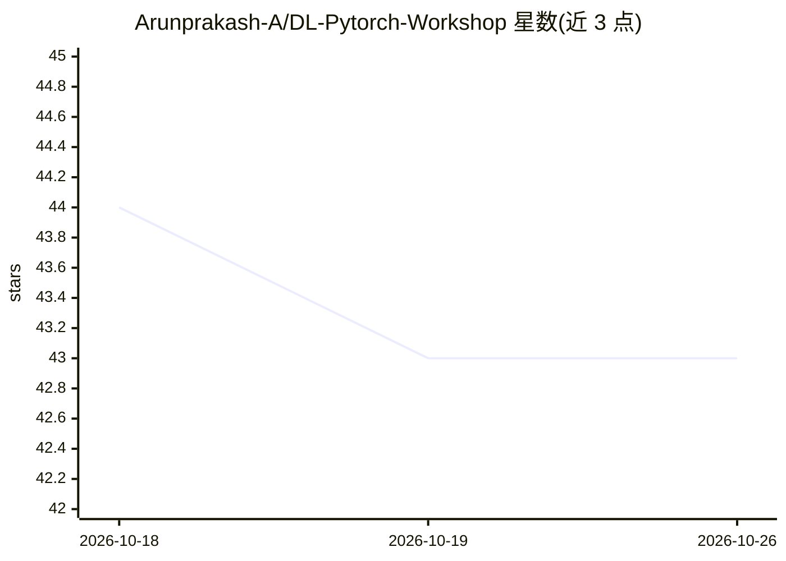

# Arunprakash-A/DL-Pytorch-Workshop

⭐ 43 · 推送 2026-04-07 · [GitHub](https://github.com/Arunprakash-A/DL-Pytorch-Workshop) · [官网](https://arunprakash-a.github.io/DL-Pytorch-Workshop/) · 个人维护

**PyTorch 与 Hugging Face 深度学习教程仓库（幻灯片+Colab 笔记本）**

由个人维护的深度学习教学仓库：配套 PyTorch 与 Transformers 主题的幻灯片，以及 11 个按难度分级的 Colab 笔记本，内容覆盖张量、Autograd、nn.Module 与数据工具、CNN 图像分类、RNN 序列分类、预训练模型使用与微调、数据集加载、BPE 自定义分词器、自定义 Seq2Seq Transformer 训练、梯度累积持续预训练等。另附分布式训练（DDP/FSDP）与 CUDA 多 GPU 使用指引。学习者在 Colab 环境中运行，不提供独立安装包。

## 筛选速览

| 维度 | 判定 | 备注 |
|---|---|---|
| AI 角色 | `ai-knowledge` | 知识聚合/清单类 |
| 许可风险 | `none` | — |
| 部署形态 | `None` |  |
| 模型依赖 | — | README 未给出锁定关系 |
| 硬件要求 | — | 无带数字的原话,不猜 |
| 安装摩擦 | `medium` | 含编译或系统依赖之一 |
| 成熟度 | — | 结构信号不足 |

## 能力要点

- 11 个按 Easy/Medium/Hard 分级的 Colab 教学笔记本
- 覆盖从张量、Autograd 到自定义 Transformer 训练的完整路径
- 配套幻灯片与分布式训练、CUDA 资源指引

## 适用场景

- 系统学习 PyTorch 基础与 Hugging Face 微调流程
- 动手实践自定义分词器与 Seq2Seq Transformer 训练
- 了解分布式训练与多 GPU 使用方式

## 场景标签

`教程课程` · 领域:学习与行业

## 证据(README 行号)

> L1: # Deep Learning with Pytorch and Hugging Face
> L14:  ## Colab Notebooks

## 星数曲线

2026-10-18 44 → 2026-10-26 43（-1）

---
*卡片 v1 · prompt 1.4 · 生成 2026-10-25 · 置信度 high · 依据 README sha `c7d24004bfd5` · [字段定义](../../DATASET.md)*
