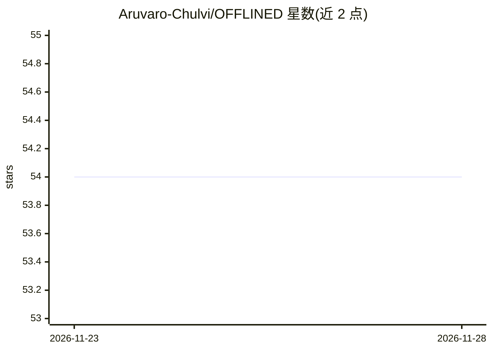

# Aruvaro-Chulvi/OFFLINED

⭐ 54 · NOASSERTION · 推送 2026-11-21 · [GitHub](https://github.com/Aruvaro-Chulvi/OFFLINED) · [官网](https://www.offlined.org/) · 组织维护

**给离线环境用户的本地知识+AI 套件：维基、地图、星空与本地 AI**

面向无网或弱网环境的离线优先桌面应用，聚合 Wikipedia ZIM 离线阅读、OpenStreetMap 离线地图、海底与星空（planetarium）、课程库 WikiAula、个人文件管理（照片/邮件/联系人/保险箱）。内置本地 AI（Michael Encartha）提供聊天、学习代理与带维基出处的回答，并可接入用户已有的 Ollama、LM Studio 或 llama-server。仅提供 Windows 可执行文件，免安装便携运行；源代码不公开，生态部分（工具树、课程、插件 SDK、3D 模型）以开源姊妹项目形式发布。个人使用免费，支持 10 种语言。

## 筛选速览

| 维度 | 判定 | 备注 |
|---|---|---|
| AI 角色 | `ai-enhanced` | 去掉 AI 部分产品仍成立 |
| 许可风险 | `none` | NOASSERTION |
| 部署形态 | `desktop` | 安装包/桌面程序 |
| 模型依赖 | local-ok | 支持本地模型 |
| 硬件要求 | — | 无带数字的原话,不猜 |
| 安装摩擦 | `low` | 无编译、无系统依赖或容器化 |
| 成熟度 | — | 结构信号不足 |

## 能力要点

- 本地 AI 聊天与学习代理，回答引用 Wikipedia 来源文章
- 可接入用户已有的 Ollama、LM Studio 或 llama-server
- 离线 Wikipedia/地图/星空/海图等内容生态，首次下载后全本地运行
- 便携模式：从文件夹、外接硬盘或 USB 直接运行，无云后端、无遥测

## 适用场景

- 网络条件差的学校、图书馆和教育项目中离线使用知识库与练习题
- 注重隐私的用户在本地处理文件与 AI 聊天
- 户外与应急场景下离线查阅地图、海图与星空
- 研究者/档案员长期自托管参考资料

## 场景标签

`聊天机器人` `知识库管理` · 领域:对话与助手

## 证据(README 行号)

> L12: We depend on the internet more than we realise. Take back control with OFFLINED: no internet, no permissions, no mi
> L51: - **🤖 Michael Encartha, your local AI** — chat, study agents and answers that cite the Wikipedia articles they come
> L93: Offlined's own source code is not public, but **the sister projects are open to everyone**. You don't need to be a 

## 星数曲线

2026-11-23 54 → 2026-11-28 54（+0）

---
*卡片 v1 · prompt 1.4 · 生成 2026-11-23 · 置信度 mid · 依据 README sha `35c708ce8094` · [字段定义](../../DATASET.md)*
