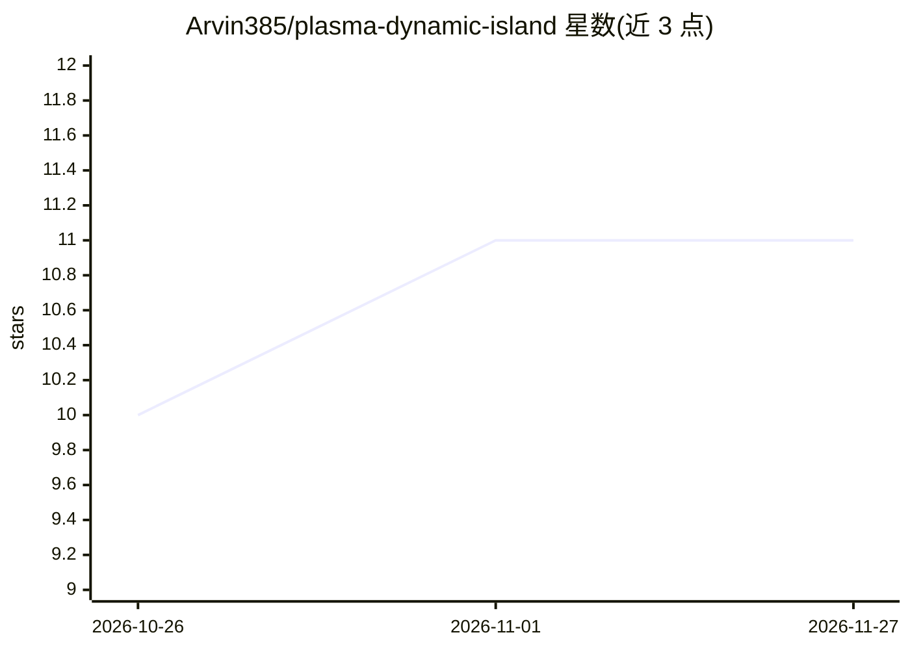

# Arvin385/plasma-dynamic-island

⭐ 11 · QML · MIT · 推送 2026-10-26 · [GitHub](https://github.com/Arvin385/plasma-dynamic-island) · 个人维护

**KDE Plasma 6 面板动态岛小组件：显示本地 LLM、媒体与系统状态**

为 KDE Plasma 6 面板提供的动态岛风格小组件，由 QML 面板控件与 Bash 后台采集脚本两部分构成：脚本以约每秒 3 次的频率轮询系统负载、媒体播放、包管理器安装进度与本地 LLM 运行状态，写入缓存 JSON 供控件读取；悬停展开 System、Media、Local LLM、Packages 四张卡片，点击可跳转对应窗口。支持 Wayland，在 Arch/Manjaro 上构建测试。依赖 Plasma 6 与 python3，媒体标题、GPU 利用率与 LLM 卡片需安装可选组件。

## 筛选速览

| 维度 | 判定 | 备注 |
|---|---|---|
| AI 角色 | `ai-enhanced` | 去掉 AI 部分产品仍成立 |
| 许可风险 | `permissive` | MIT |
| 部署形态 | `None` |  |
| 模型依赖 | local-ok | 支持本地模型 |
| 硬件要求 | — | 无带数字的原话,不猜 |
| 安装摩擦 | `medium` | 含编译或系统依赖之一 |
| 成熟度 | — | 结构信号不足 |

## 能力要点

- 悬停展开四类卡片：System / Media / Local LLM / Packages
- 后台脚本约每秒 3 次轮询状态并通过缓存 JSON 传递给控件
- 支持显示本地模型名称与生成速度（tokens/sec）
- 通过 playerctl、gputop、nvidia-smi 等可选组件解锁更多细节

## 适用场景

- 在 Plasma 面板上一眼查看下载、播放与系统负载
- 本地运行 Ollama 或 LM Studio 时实时查看模型生成速度
- 安装/卸载软件包时在面板跟踪进度

## 场景标签

 · 领域:桌面工具/Linux 定制

## 证据(README 行号)

> L28: Hover and it expands into four cards — **System**, **Media**, **Local LLM**, **Packages** — always all four, so you
> L80: |LM Studio / Ollama|The Local LLM card|
> L99: |`scripts/di-v13-collector.sh`|Polls system, media, package, and LLM state|

## 星数曲线

2026-10-26 10 → 2026-11-27 11（+1）

---
*卡片 v1 · prompt 1.4 · 生成 2026-11-19 · 置信度 high · 依据 README sha `b5945fc25f7f` · [字段定义](../../DATASET.md)*
