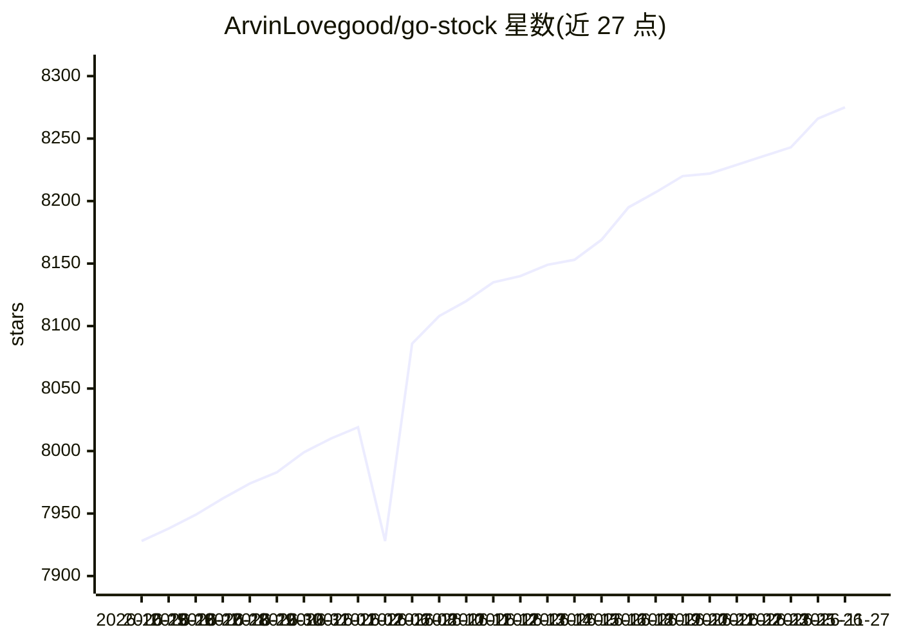

# ArvinLovegood/go-stock

⭐ 8,275 · Go · GPL-3.0 · 推送 2026-11-26 · [GitHub](https://github.com/ArvinLovegood/go-stock) · [官网](https://go-stock.sparkmemory.top) · 个人维护 · 中文 README

**面向个人投资者的 AI 股票分析与选股桌面工具**

基于 Wails 和 NaiveUI 开发的股票分析桌面应用，支持 A股/港股/美股行情、ETF 基金搜索与 K 线分析。AI 侧内置三种模式的智能体（React/PlanExecute/DeepAgents）、150+ 数据工具、技能系统、MCP 扩展、视觉理解（截图问股/K线图分析），并提供涨跌报警与飞书/钉钉推送。数据保留在本地，支持 OpenAI 接口格式、Ollama、LMStudio、DeepSeek、硅基流动等平台。开发环境主要基于 Windows10+，其他平台未测试或功能受限；README 声明分析结果仅供学习研究。

## 筛选速览

| 维度 | 判定 | 备注 |
|---|---|---|
| AI 角色 | `ai-native` | 本体是模型或模型工具 |
| 许可风险 | `viral` | GPL-3.0 |
| 部署形态 | `desktop` | 安装包/桌面程序 |
| 模型依赖 | local-ok | 支持本地模型 |
| 硬件要求 | — | 无带数字的原话,不猜 |
| 安装摩擦 | `low` | 无编译、无系统依赖或容器化 |
| 成熟度 | — | 结构信号不足 |

## 能力要点

- 内置 AI 智能体（React/PlanExecute/DeepAgents 三种模式）与 150+ AI 数据工具
- AI 视觉理解支持截图问股与 K 线图分析
- 支持涨跌报警定时预警与飞书/钉钉推送
- 提供 Windows 绿色版与 macOS/Linux 构建

## 适用场景

- 查看 A股/港股/美股行情并用 AI 分析个股资金与财务
- 让 AI 智能体根据指标辅助选股
- K线图截图后让 AI 进行图面分析
- 设置涨跌报警并通过飞书/钉钉接收推送

## 场景标签

`金融量化` · 领域:学习与行业

## 证据(README 行号)

> L20: - 本项目基于Wails和NaiveUI开发，结合AI大模型构建的股票分析工具。
> L22: - 内置 AI 智能体（React/PlanExecute/DeepAgents 三种模式）、150+ AI 数据工具（含 5 个常驻选股工具）、技能系统、MCP 扩展与浮动 AI 助手，支持视觉理解图片对话（截图问股/K线图分析

## 星数曲线

2026-10-25 7,928 → 2026-11-27 8,275（+347）

---
*卡片 v1 · prompt 1.4 · 生成 2026-11-26 · 置信度 high · 依据 README sha `0c61dc8e479c` · [字段定义](../../DATASET.md)*
