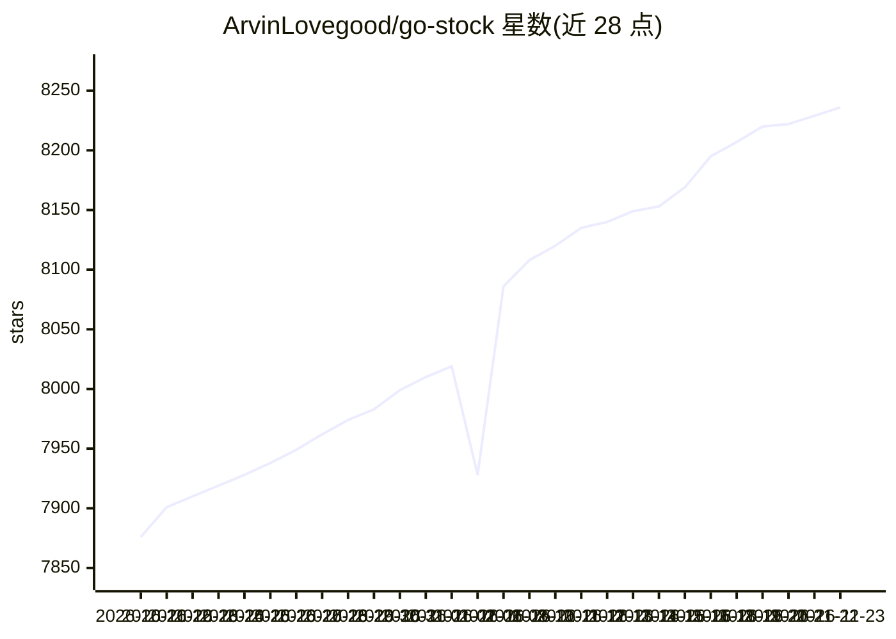

# ArvinLovegood/go-stock

⭐ 8,236 · Go · GPL-3.0 · 推送 2026-11-22 · [GitHub](https://github.com/ArvinLovegood/go-stock) · [官网](https://go-stock.sparkmemory.top) · 个人维护 · 中文 README

**给股民的桌面端 AI 股票分析工具，覆盖A股/港股/美股**

基于 Wails 与 NaiveUI 构建的桌面股票分析工具，提供 A股/港股/美股行情、ETF 基金搜索、K线技术指标（成交量分布/神奇九转/自动背离等）、资金流向、龙虎榜与资讯聚合。AI 侧内置三种智能体模式、150+ 数据工具、技能系统与 MCP 扩展，支持截图问股等视觉理解，并提供复盘回测、买卖点信号监控与飞书/钉钉推送。数据保留在本地。开发环境基于 Windows10+，其他平台未测试或功能受限，另有赞助计划与 VIP 技能权限。

## 筛选速览

| 维度 | 判定 | 备注 |
|---|---|---|
| AI 角色 | `ai-native` | 本体是模型或模型工具 |
| 许可风险 | `viral` | GPL-3.0 |
| 部署形态 | `desktop` | 安装包/桌面程序 |
| 模型依赖 | local-ok | 支持本地模型 |
| 硬件要求 | — | 无带数字的原话,不猜 |
| 安装摩擦 | `low` | 无编译、无系统依赖或容器化 |
| 成熟度 | — | 结构信号不足 |

## 能力要点

- 内置 React/PlanExecute/DeepAgents 三种 AI 智能体模式与 150+ AI 数据工具
- 支持视觉理解图片对话（截图问股/K线图分析）
- K线分析含 13 种绘图工具、波浪理论与自动背离等指标
- 推荐回测统计与提示词模板回测，支持飞书/钉钉推送

## 适用场景

- 日常查看 A股/港股/美股行情与个股资金流向
- 让 AI 帮我做资讯热点和财务面的分析总结
- 用提示词模板回测对比不同选股策略的历史表现
- 设置涨跌预警并通过飞书/钉钉接收推送

## 场景标签

`金融量化` · 领域:学习与行业

## 证据(README 行号)

> L18: - 本项目基于Wails和NaiveUI开发，结合AI大模型构建的股票分析工具。
> L20: - 内置 AI 智能体（React/PlanExecute/DeepAgents 三种模式）、150+ AI 数据工具、技能系统、MCP 扩展与浮动 AI 助手，支持视觉理解图片对话（截图问股/K线图分析）。

## 星数曲线

2026-10-21 7,876 → 2026-11-23 8,236（+360）

---
*卡片 v1 · prompt 1.4 · 生成 2026-11-23 · 置信度 high · 依据 README sha `bf8b18aa121d` · [字段定义](../../DATASET.md)*
