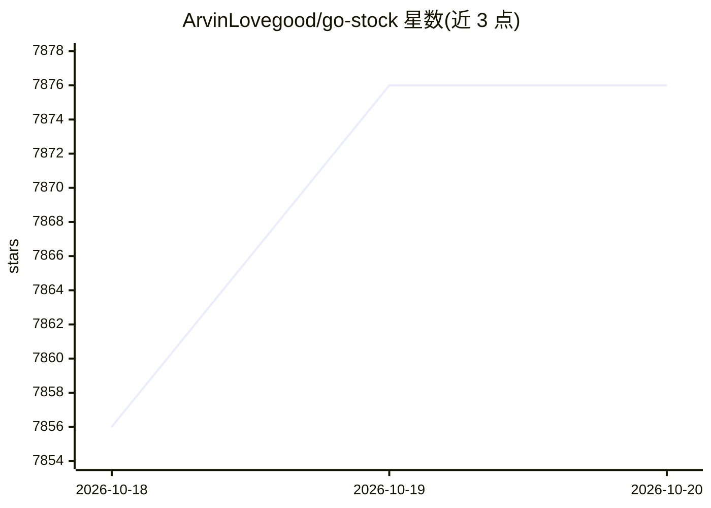

# ArvinLovegood/go-stock

⭐ 7,876 · Go · GPL-3.0 · 推送 2026-10-19 · [GitHub](https://github.com/ArvinLovegood/go-stock) · [官网](https://go-stock.sparkmemory.top) · 个人维护 · 中文 README

**面向个人投资者的 AI 股票分析与选股桌面工具**

基于 Wails + NaiveUI 的桌面股票工具，覆盖 A股/港股/美股行情、场内 ETF、K线分析（复权/波浪理论/13种绘图工具）、资金流向、龙虎榜与政策新闻聚合。AI 部分内置三种模式的智能体、150+ 数据工具、MCP 扩展、视觉理解与知识库，支持接入 OpenAI/Ollama/LMStudio/DeepSeek/智谱/火山方舟等多个平台，数据保留本地。Windows 提供绿色版可执行文件，macOS/Linux 提供构建产物；开发环境主要基于 Windows10+，其他平台功能受限。部分功能（如后台信号监控）需赞助 VIP2。

## 筛选速览

| 维度 | 判定 | 备注 |
|---|---|---|
| AI 角色 | `ai-enhanced` | 去掉 AI 部分产品仍成立 |
| 许可风险 | `viral` | GPL-3.0 |
| 部署形态 | `desktop` | 安装包/桌面程序 |
| 模型依赖 | local-ok | 支持本地模型 |
| 硬件要求 | — | 无带数字的原话,不猜 |
| 安装摩擦 | `low` | 无编译、无系统依赖或容器化 |
| 成熟度 | `idea` | |

## 能力要点

- 内置 React/PlanExecute/DeepAgents 三种模式的 AI 智能体与 150+ AI 数据工具
- 支持 K线分析、龙虎榜、游资动向、股指期货持仓、合约行情等行情功能
- 可接入 OpenAI/Ollama/LMStudio/DeepSeek/硅基流动/火山方舟等多家模型平台
- 提示词模板回测与推荐回测统计，含防未来数据机制

## 适用场景

- 查看 A股/港股/美股行情并做 K线技术分析
- 让 AI 智能体基于行情与资讯数据辅助选股与复盘
- 设置买卖点信号监控并通过飞书/钉钉接收推送
- 对比多个提示词模板的历史回测表现

## 场景标签

`金融量化` `提示工程` · 领域:Agent 开发

## 证据(README 行号)

> L16: - 本项目基于Wails和NaiveUI开发，结合AI大模型构建的股票分析工具。
> L18: - 内置 AI 智能体（React/PlanExecute/DeepAgents 三种模式）、150+ AI 数据工具、技能系统、MCP 扩展与浮动 AI 助手，支持视觉理解图片对话（截图问股/K线图分析）。
> L22: - 本项目仅供娱乐，不喜勿喷，AI分析股票结果仅供学习研究，投资有风险，请谨慎使用。

## 星数曲线

2026-10-18 7,856 → 2026-10-20 7,876（+20）

---
*卡片 v1 · prompt 1.4 · 生成 2026-10-20 · 置信度 high · 依据 README sha `215881a6106e` · [字段定义](../../DATASET.md)*
