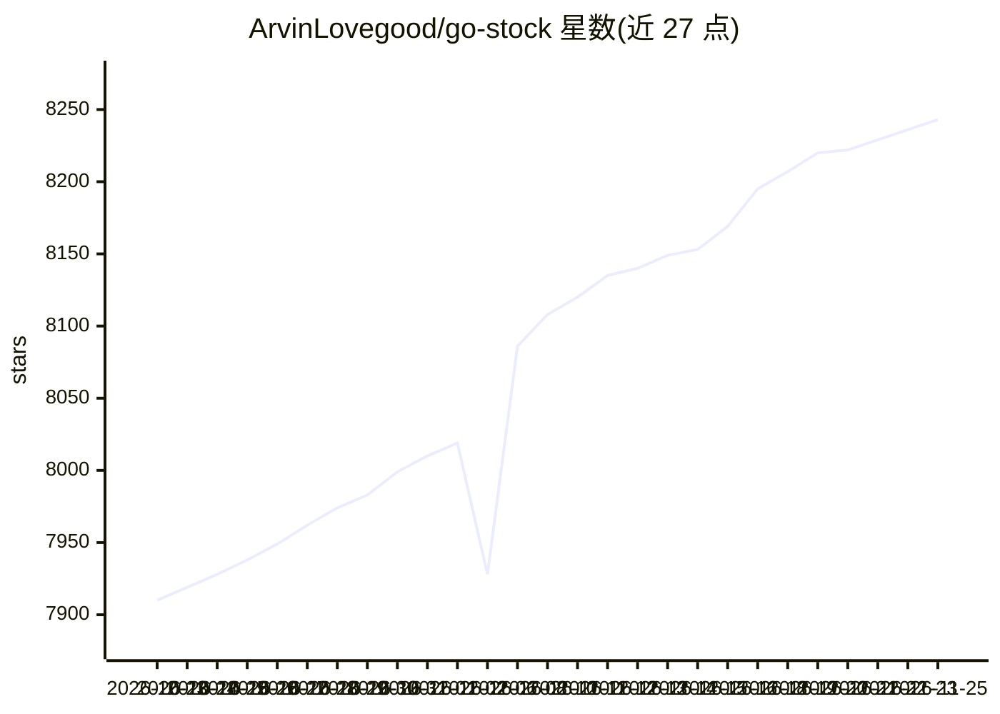

# ArvinLovegood/go-stock

⭐ 8,243 · Go · GPL-3.0 · 推送 2026-11-23 · [GitHub](https://github.com/ArvinLovegood/go-stock) · [官网](https://go-stock.sparkmemory.top) · 个人维护 · 中文 README

**AI 赋能的 A股/港股/美股分析与选股桌面工具**

基于 Wails 和 NaiveUI 开发的桌面股票分析工具，提供 A股/港股/美股行情、场内 ETF 搜索、K 线技术指标（15 路买卖点信号体系）、龙虎榜、涨停梯队、异动监控与定时预警推送（飞书/钉钉）。AI 部分：内置 React/PlanExecute/DeepAgents 三种智能体模式、150+ 数据工具、MCP 扩展、知识库与长期记忆（chromem-go 向量库）、截图问股的视觉理解，以及 AI 智能选股、提示词模板回测与推荐收益统计。数据保留在本地，开发环境主要基于 Windows10+，其他平台未测试或功能受限。

## 筛选速览

| 维度 | 判定 | 备注 |
|---|---|---|
| AI 角色 | `ai-native` | 本体是模型或模型工具 |
| 许可风险 | `viral` | GPL-3.0 |
| 部署形态 | `desktop` | 安装包/桌面程序 |
| 模型依赖 | local-ok | 支持本地模型 |
| 硬件要求 | — | 无带数字的原话,不猜 |
| 安装摩擦 | `low` | 无编译、无系统依赖或容器化 |
| 成熟度 | — | 结构信号不足 |

## 能力要点

- 内置三种 Agent 模式、150+ AI 数据工具、MCP 扩展与浮动 AI 助手
- 支持视觉理解图片对话（截图问股/K线图分析）
- 提示词模板回测与推荐回测统计（胜率/回撤/收益对比沪深300）
- 知识库与长期记忆基于 chromem-go 向量库，数据保留在本地

## 适用场景

- 查看 A股/港股/美股行情并让 AI 分析个股资金与财务
- 用提示词模板回测对比不同选股提示词的历史表现
- 盘中通过飞书/钉钉接收买卖点信号与涨跌预警推送
- 接入本地 Ollama/LMStudio 模型做离线 AI 分析

## 场景标签

`金融量化` · 领域:学习与行业

## 证据(README 行号)

> L20: - 本项目基于Wails和NaiveUI开发，结合AI大模型构建的股票分析工具。
> L22: - 内置 AI 智能体（React/PlanExecute/DeepAgents 三种模式）、150+ AI 数据工具、技能系统、MCP 扩展与浮动 AI 助手，支持视觉理解图片对话（截图问股/K线图分析）。
> L26: - 本项目仅供娱乐，不喜勿喷，AI分析股票结果仅供学习研究，投资有风险，请谨慎使用。

## 星数曲线

2026-10-23 7,910 → 2026-11-25 8,243（+333）

---
*卡片 v1 · prompt 1.4 · 生成 2026-11-24 · 置信度 high · 依据 README sha `c8bf690ca1ef` · [字段定义](../../DATASET.md)*
