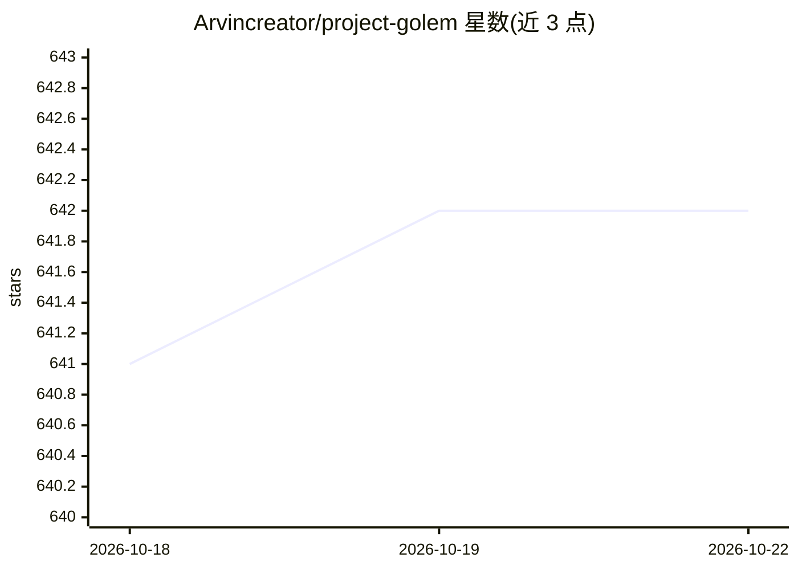

# Arvincreator/project-golem

⭐ 642 · JavaScript · NOASSERTION · 推送 2026-06-22 · [GitHub](https://github.com/Arvincreator/project-golem) · 个人维护 · 中文 README

**面向个人的 OS 级自主 AI 代理系统：可对话、行动、长期记忆**

Node.js 实现的 AI 工作系统，将语言模型与操作能力整合在同一执行核心，通过 Web Dashboard 提供对话、技能挂载（MCP/Skills）、长期记忆管理与检索、多代理讨论与共识输出，另含文字 RPG、台股/美股看板、协作日历、羁绊日记与 Telegram/Discord 通道。后端可选 Gemini Web（Playwright 浏览器接入）、Ollama 或 LM Studio（OpenAI 兼容本地 API）。安装经 setup.sh 脚本，部署支持 Docker Compose；需要 Node.js >=20 <23，Gemini Web 模式需 Chromium/Chrome。授权为 Source-Available Non-Commercial，另有商业许可文件。

## 筛选速览

| 维度 | 判定 | 备注 |
|---|---|---|
| AI 角色 | `ai-native` | 本体是模型或模型工具 |
| 许可风险 | `none` | NOASSERTION |
| 部署形态 | `self-host` | docker 或自建部署 |
| 模型依赖 | local-ok | 支持本地模型 |
| 硬件要求 | — | 无带数字的原话,不猜 |
| 安装摩擦 | `low` | 无编译、无系统依赖或容器化 |
| 成熟度 | — | 结构信号不足 |

## 能力要点

- 多后端大脑：gemini / ollama / lmstudio 可按成本、隐私、效能切换
- 长期记忆（lancedb-pro / native 模式）含摘要压缩与检索
- Interactive Multi-Agent 角色群组讨论与共识输出
- MCP 工具扩充与技能系统，含 Action Gate 高风险操作核准流

## 适用场景

- 把对话、记忆、工具、设定集中到一个 Dashboard 作为个人 AI 工作台
- 用 Ollama/LM Studio 在本机私有网络内运行模型与记忆数据
- 建立多角色代理讨论并整理成可执行结论
- 用文字 RPG、羁绊日记、协作日历做长期创作与生活陪伴

## 场景标签

`AI 助手` `Agent 记忆` `多智能体` · 领域:Agent 开发

## 证据(README 行号)

> L16: Project Golem 不是單純聊天機器人，而是一套可運行的 AI 工作系統。
> L28: - `Gemini Web`（Browser-in-the-Loop，透過 Playwright）
> L57: |多後端大腦|支援 `gemini`、`ollama`、`lmstudio`，可依成本、隱私、效能切換。|

## 星数曲线

2026-10-18 641 → 2026-10-22 642（+1）

---
*卡片 v1 · prompt 1.4 · 生成 2026-10-21 · 置信度 high · 依据 README sha `5bdc173475f7` · [字段定义](../../DATASET.md)*
