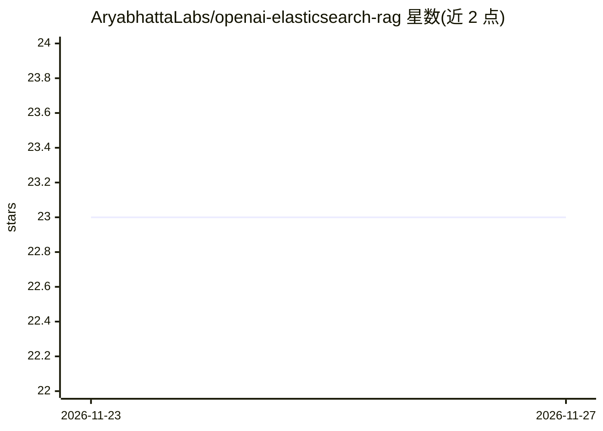

# AryabhattaLabs/openai-elasticsearch-rag

⭐ 23 · Python · MIT · 推送 2026-11-22 · [GitHub](https://github.com/AryabhattaLabs/openai-elasticsearch-rag) · 组织维护

**OpenAI + Elasticsearch 的 RAG 问答示例应用**

面向长文本提供问答体验的 RAG 参考应用：以 Elasticsearch 作为向量库存储句级嵌入并执行检索，调用 OpenAI API 生成嵌入与答案。应用以 Python 编写，经 venv/pip 安装依赖，Elasticsearch 通过 Docker 单节点运行；提供索引创建、文本索引与查询的 HTTP API 及示例脚本，附《世界人权宣言》示例数据。依赖 OpenAI API Key，本地仅限测试用途。

## 筛选速览

| 维度 | 判定 | 备注 |
|---|---|---|
| AI 角色 | `ai-native` | 本体是模型或模型工具 |
| 许可风险 | `permissive` | MIT |
| 部署形态 | `self-host` | docker 或自建部署 |
| 模型依赖 | — | README 未给出锁定关系 |
| 硬件要求 | — | 无带数字的原话,不猜 |
| 安装摩擦 | `low` | 无编译、无系统依赖或容器化 |
| 成熟度 | `idea` | |

## 能力要点

- Elasticsearch 9.x 作为向量库存储句级嵌入并检索
- OpenAI 生成嵌入与答案，模型名可通过 .env 配置
- 已索引句子跳过，重复索引安全
- 提供 HTTP API 与示例脚本及示例文本数据

## 适用场景

- 对长篇文本文档搭建问答服务
- 学习 RAG 检索与生成的参考实现
- 向自有文本建立向量索引并查询

## 场景标签

`RAG` · 领域:知识与检索

## 证据(README 行号)

> L7: RAG *(Retrieval-Augmented Generation)* Application to offer Q&A on a long format text using OpenAI and
> L10: - using ElasticSearch as VectorDB to store indexed data and use it for Retrieval.
> L11: - using OpenAI to create embeddings and generate answers to the questions after retrieving relevant chuncks from ES

## 星数曲线

2026-11-23 23 → 2026-11-27 23（+0）

---
*卡片 v1 · prompt 1.4 · 生成 2026-11-23 · 置信度 high · 依据 README sha `fbad869670ef` · [字段定义](../../DATASET.md)*
