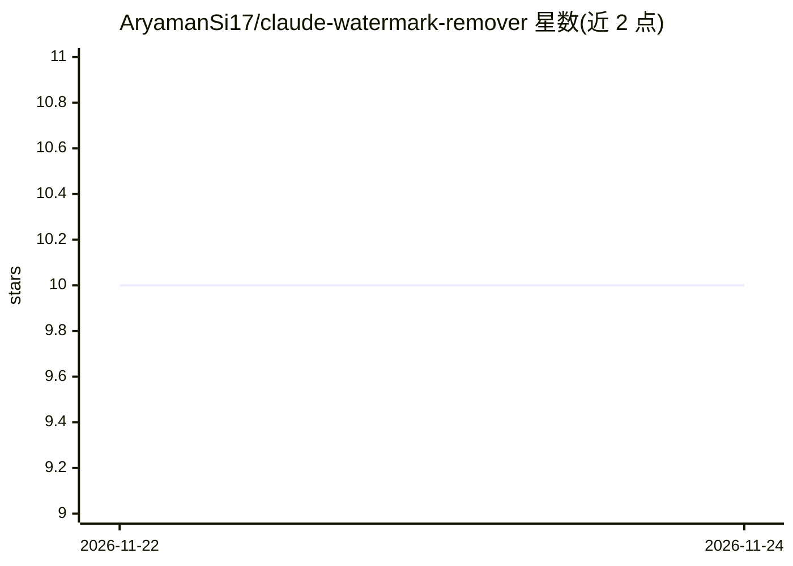

# AryamanSi17/claude-watermark-remover

⭐ 10 · Python · MIT · 推送 2026-11-23 · [GitHub](https://github.com/AryamanSi17/claude-watermark-remover) · [官网](https://aryamansi17.github.io/claude-watermark-remover/) · 个人维护

**清除文本与文件中 AI 出处标记的 Python CLI 工具**

以标准库为主的 CLI 工具，分三层处理 AI 生成内容的出处标记：Layer A 清理不可见 Unicode（零宽字符、bidi 控制符、tag 字符），文件清理器移除 PNG/JPEG/WebP/PDF/DOCX/SVG/HTML/Markdown 中的 C2PA 清单与 EXIF/XMP 元数据；对 Claude 统计性文本水印仅提供 best-effort 同义改写，并明确声明外部无法验证其移除。发现项按 confirmed/probable/informational 三级置信度分级处理，PDF 清理依赖外部工具 exiftool 与 qpdf。

## 筛选速览

| 维度 | 判定 | 备注 |
|---|---|---|
| AI 角色 | `ai-enhanced` | 去掉 AI 部分产品仍成立 |
| 许可风险 | `permissive` | MIT |
| 部署形态 | `library` | 以包/库形式分发 |
| 模型依赖 | — | README 未给出锁定关系 |
| 硬件要求 | — | 无带数字的原话,不猜 |
| 安装摩擦 | `low` | 无编译、无系统依赖或容器化 |
| 成熟度 | — | 结构信号不足 |

## 能力要点

- 结构化解析 JUMBF/UUID 移除 C2PA 清单（PNG/JPEG/WebP/PDF）
- 三级置信度分级，probable 级默认仅报告需 --aggressive 才移除
- inspect 命令检测到 confirmed 项时退出码 1，可作 CI 门禁
- 原子写入（临时文件+重命名）并拒绝穿透符号链接写入

## 适用场景

- 检查并清理 AI 工具输出文件中的元数据与 C2PA 标记
- 在 CI 流水线中检测提交文件是否含不可见 AI 标记
- 批量去除文档中 AI 工具留下的零宽字符与 frontmatter 字段

## 场景标签

 · 领域:内容安全/元数据清理

## 证据(README 行号)

> L8: Stdlib-first tool for removing AI provenance marks from text and files —
> L51: > **3. Generic AI-tool invisible-character and metadata marks — reliably removed.**

## 星数曲线

2026-11-22 10 → 2026-11-24 10（+0）

---
*卡片 v1 · prompt 1.4 · 生成 2026-11-22 · 置信度 high · 依据 README sha `f726b481b31a` · [字段定义](../../DATASET.md)*
