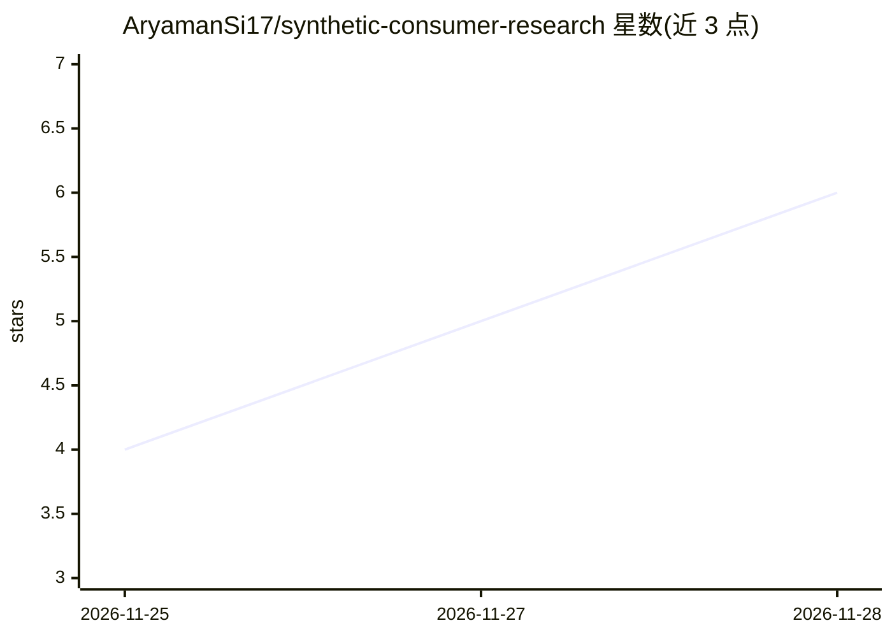

# AryamanSi17/synthetic-consumer-research

⭐ 6 · Python · MIT · 推送 2026-11-23 · [GitHub](https://github.com/AryamanSi17/synthetic-consumer-research) · [官网](https://synthetic.aryaman.club) · 个人维护

**面向产品人的 LLM 合成消费者调研 Agent Skill（SSR 评分）**

以 SKILL.md 形式分发的 Agent Skill，可在 Claude Code、Codex、Cursor、Antigravity、Gemini CLI 及终端中运行合成消费者调研：生成带人口属性的 persona，逐个采集自由文本回答，再用 Semantic Similarity Rating（arXiv 2510.08338）把回答映射为 1–5 购买意愿概率分布，输出均分、top-2-box、分组结果与报告。嵌入可用 OpenAI text-embedding-3-small 或本地 sentence-transformers；README 提醒验证范围窄、仅作初筛。

## 筛选速览

| 维度 | 判定 | 备注 |
|---|---|---|
| AI 角色 | `ai-native` | 本体是模型或模型工具 |
| 许可风险 | `permissive` | MIT |
| 部署形态 | `library` | 以包/库形式分发 |
| 模型依赖 | — | README 未给出锁定关系 |
| 硬件要求 | — | 无带数字的原话,不猜 |
| 安装摩擦 | `low` | 无编译、无系统依赖或容器化 |
| 成熟度 | — | 结构信号不足 |

## 能力要点

- SSR 评分：自由文本→嵌入→与参考句余弦相似度→1–5 概率分布
- 每个 persona 独立 LLM 调用，避免回答互相复制
- 可选脚本支持多方案对比与把反对意见转为访谈问题
- 支持 --human 参数与真实调研结果对齐校验

## 适用场景

- 在投入真实调研前测试产品概念与定价
- 对比落地页文案或两个产品版本哪个更能打动消费者
- 把合成调研中的强反对意见整理成真实用户访谈问题

## 场景标签

`数据分析` · 领域:效率与自动化

## 证据(README 行号)

> L5: **Test a product idea on 100 simulated customers in a few minutes.** This is an open Agent Skill (`SKILL.md`) that w
> L35: 3. **Scores every answer with SSR.** Each answer becomes a probability for each rating from 1 to 5, not a single gu
> L55: SSR lets the model answer like a person ("I like it, but $29 is a lot for me right now"). It then measures how clos

## 星数曲线

2026-11-25 4 → 2026-11-28 6（+2）

---
*卡片 v1 · prompt 1.4 · 生成 2026-11-24 · 置信度 mid · 依据 README sha `0bea6a3f2278` · [字段定义](../../DATASET.md)*
