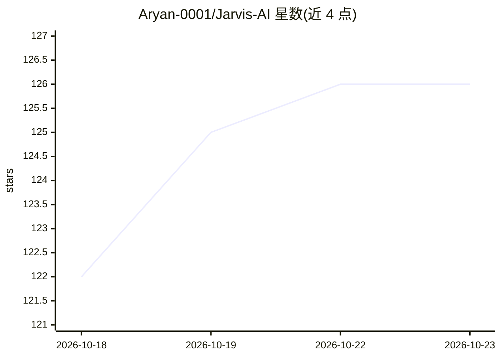

# Aryan-0001/Jarvis-AI

⭐ 126 · Dart · MIT · 推送 2026-01-27 · [GitHub](https://github.com/Aryan-0001/Jarvis-AI) · [官网](https://aryan-0001.github.io/Jarvis-AI/) · 个人维护

**语音激活的个人 AI 助手应用：Flutter Android 版与 Windows Python 版**

提供两个组件：一是 Dart/Flutter 编写的 Android 应用，通过 Google Generative AI 生成对话回答，集成 speech_to_text 语音输入、flutter_tts 语音输出，可启动应用、播报天气时间、讲笑话；二是 Windows PowerShell/CMD 下运行的 Python 助手，基于 SpeechRecognition 与 pyttsx3 实现语音交互，可用 PyAutoGUI 打开应用、搜网页、放音乐、在终端写代码、经 WhatsApp 发消息。安装需自行配置 Flutter/Python 环境与 Google API key；README 标注 APK 处于维护状态，最新 APK 见 Releases。

## 筛选速览

| 维度 | 判定 | 备注 |
|---|---|---|
| AI 角色 | `ai-native` | 本体是模型或模型工具 |
| 许可风险 | `permissive` | MIT |
| 部署形态 | `None` |  |
| 模型依赖 | — | README 未给出锁定关系 |
| 硬件要求 | — | 无带数字的原话,不猜 |
| 安装摩擦 | `low` | 无编译、无系统依赖或容器化 |
| 成熟度 | `idea` | |

## 能力要点

- Flutter Android 版集成 Google Generative AI 生成对话
- 语音输入（speech_to_text / SpeechRecognition）与语音输出（TTS）
- Windows 版可用 PyAutoGUI 自动化 UI 任务、经 WhatsApp 发消息
- Android Intents 与 URL Launcher 启动应用/打开网页

## 适用场景

- 在 Android 手机上用语音与 AI 助手对话并让它启动应用
- 在 Windows 上用语音指令打开应用、搜网页、放音乐
- 让助手经 WhatsApp 向联系人或号码发消息

## 场景标签

`AI 助手` `语音 Agent` · 领域:对话与助手

## 证据(README 行号)

> L11: - Purpose: A voice-activated assistant that uses Google’s Generative AI, integrates speech-to-text, text-to-speech,
> L27: - Purpose: A voice-activated assistant for Windows that can perform tasks like searching the web, opening apps, pla

## 星数曲线

2026-10-18 122 → 2026-10-23 126（+4）

---
*卡片 v1 · prompt 1.4 · 生成 2026-10-23 · 置信度 high · 依据 README sha `23b5042a2a7d` · [字段定义](../../DATASET.md)*
