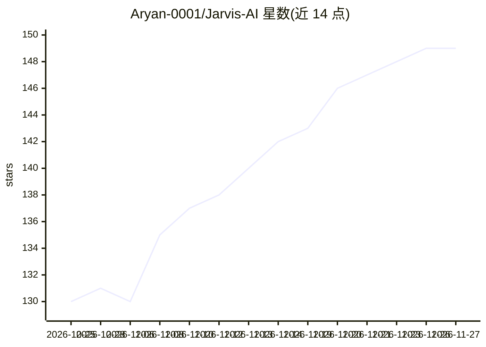

# Aryan-0001/Jarvis-AI

⭐ 149 · Dart · MIT · 推送 2026-10-29 · [GitHub](https://github.com/Aryan-0001/Jarvis-AI) · [官网](https://aryan-0001.github.io/Jarvis-AI/) · 个人维护

**为 Android 与 Windows 提供 JARVIS 风格语音助手的实验项目集**

一个 JARVIS 启发的语音助手项目集合：Android 端为 Flutter/Dart 应用，提供语音交互、语音转文字、文字转语音、Gemini 回答与 Android intents 调用；Windows 端为 Python 脚本，支持语音命令与桌面自动化；另含早期的 Jarvis Vision 目标识别原型。项目自称处于业余/实验阶段，Android APK 标记为维护中，Android 源码为独立 Dart 文件而非完整 Flutter 工程，构建前需自行补齐项目脚手架与依赖。

## 筛选速览

| 维度 | 判定 | 备注 |
|---|---|---|
| AI 角色 | `ai-native` | 本体是模型或模型工具 |
| 许可风险 | `permissive` | MIT |
| 部署形态 | `None` |  |
| 模型依赖 | — | README 未给出锁定关系 |
| 硬件要求 | — | 无带数字的原话,不猜 |
| 安装摩擦 | `low` | 无编译、无系统依赖或容器化 |
| 成熟度 | `idea` | |

## 能力要点

- Android 端集成 Gemini：语音交互、语音转文字与文字转语音
- Windows 端 Python 语音命令与桌面自动化
- 附带实验性的 Jarvis Vision 视觉/目标识别原型
- 用户自带 Gemini API key 与模型名（个人本地构建）

## 适用场景

- 在 Android 手机上搭建语音对话助手并调用系统 intents
- 用 Python 脚本通过语音命令控制 Windows 桌面操作
- 实验视觉/目标识别原型

## 场景标签

`语音 Agent` `GUI 自动化` `AI 助手` · 领域:效率与自动化

## 证据(README 行号)

> L5: A collection of experimental JARVIS-inspired assistants for **Android (Flutter/Dart)** and **Windows (Python)**, plu
> L25: |JarvisAppFlutter|Android|Flutter voice interaction, speech-to-text, text-to-speech, Gemini responses, Android inte

## 星数曲线

2026-10-25 130 → 2026-11-27 149（+19）

---
*卡片 v1 · prompt 1.4 · 生成 2026-11-27 · 置信度 high · 依据 README sha `9b2b104e548e` · [字段定义](../../DATASET.md)*
