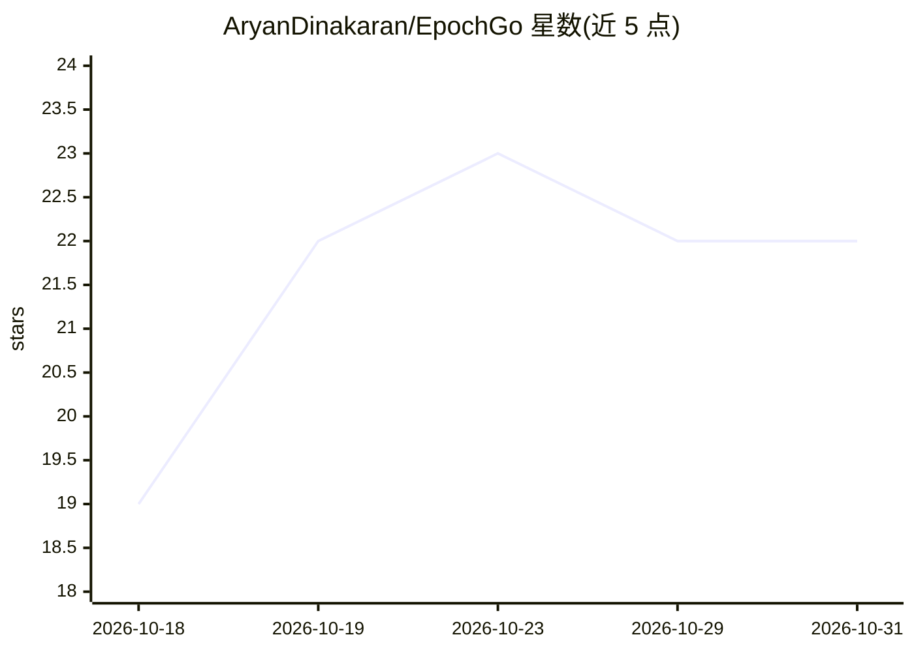

# AryanDinakaran/EpochGo

⭐ 22 · Python · MIT · 推送 2026-10-26 · [GitHub](https://github.com/AryanDinakaran/EpochGo) · 组织维护 · 中文 README

**本地多智能体 AutoML 平台：零 API key 完成清洗、调参与部署**

由 Epochlypse Research 开发的本地优先 AutoML 系统：用户上传 CSV 后，三个基于 CrewAI 与 Ollama 本地模型（推荐 qwen2.5-coder:7b）的智能体分别执行数据预处理、7 种算法基准评测与 RandomizedSearchCV 超参调优、生成 FastAPI 服务脚本与浏览器内预测面板。全程离线运行，无需云服务与 API key。以 Docker Compose 单命令启动，也可脱离 Docker 本地运行；建议 16 GB RAM，8 GB 环境可用 1.5b/3b 小模型。

## 筛选速览

| 维度 | 判定 | 备注 |
|---|---|---|
| AI 角色 | `ai-native` | 本体是模型或模型工具 |
| 许可风险 | `permissive` | MIT |
| 部署形态 | `self-host` | docker 或自建部署 |
| 模型依赖 | local-ok | 支持本地模型 |
| 硬件要求 | — | 无带数字的原话,不猜 |
| 安装摩擦 | `low` | 无编译、无系统依赖或容器化 |
| 成熟度 | — | 结构信号不足 |

## 能力要点

- 三个智能体分工：预处理、7 算法基准+调参、FastAPI 服务生成
- 零云成本、零 API key，本地 Ollama 模型驱动
- 自动剔除高基数 ID 列、防目标泄漏的 fold-aware TargetEncoder
- 生成可复现脚本、模型产物与在线 Prediction Playground

## 适用场景

- 上传 CSV 自动完成清洗、建模与调参，产出最优模型
- 在浏览器里实时测试训练好的模型预测
- 在无外网的私有环境中完成机器学习全流程

## 场景标签

`多智能体` `数据分析` · 领域:Agent 开发

## 证据(README 行号)

> L22: **EpochGo** is an open-source, local-first AutoML software system developed by **Epochlypse Research**. Simply `git
> L30: 2. 🏆 **Agent 2: Machine Learning Benchmark & Tuning Specialist**
> L41:  - Enables an interactive, in-browser **Prediction Playground** to test predictions and probabilities in real time.

## 星数曲线

2026-10-18 19 → 2026-10-31 22（+3）

---
*卡片 v1 · prompt 1.4 · 生成 2026-10-27 · 置信度 high · 依据 README sha `2f3cbf4c747c` · [字段定义](../../DATASET.md)*
