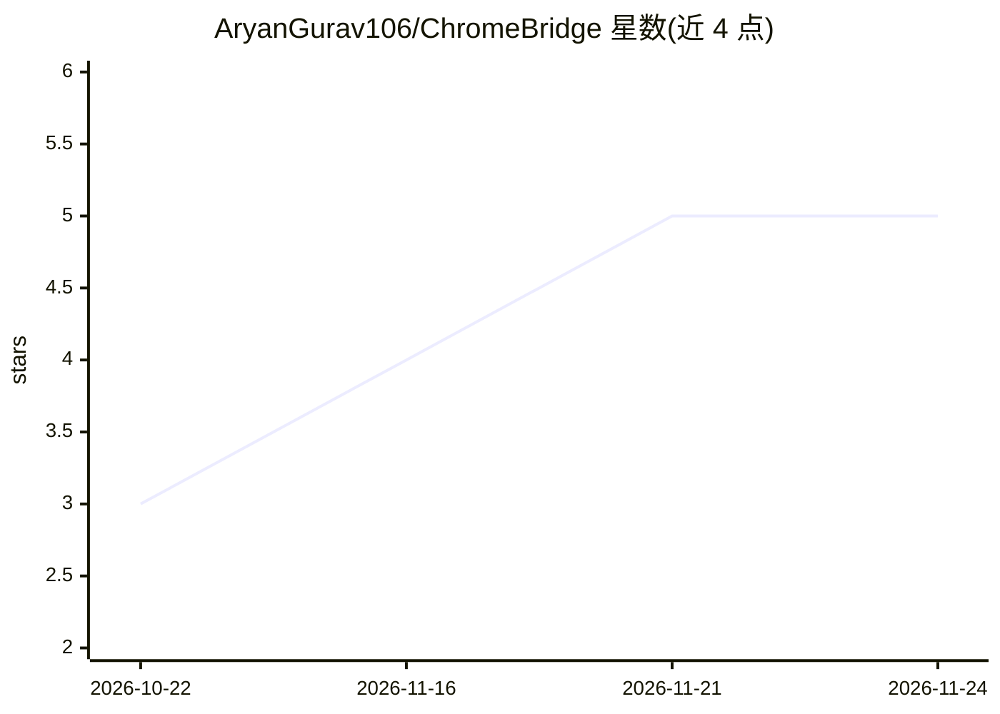

# AryanGurav106/ChromeBridge

⭐ — · [GitHub]() · 个人维护

**让 Claude Code 通过 MCP 驱动本机真实 Chrome 的桥接服务器**

由 Python MCP stdio 服务器与 Chrome MV3 扩展组成：Claude Code 作为 agent 循环，通过 31 个 MCP 工具观察和操作用户已登录的真实 Chrome 窗口（读取页面、点击、填表、上传、截图、录制并重放操作流）。服务器自身不持有 LLM key，模型调用走用户的 Claude 订阅。访问控制采用按来源授权的许可模型，由侧边面板授予/撤销，连接用 BRIDGE_TOKEN 配对。安装需 Python 3.10+、Google Chrome 与 Claude Code，以可编辑源码方式安装，扩展以开发者模式加载。

## 筛选速览

| 维度 | 判定 | 备注 |
|---|---|---|
| AI 角色 | `ai-ecosystem` | LLM/agent 周边工具 |
| 许可风险 | `permissive` | — |
| 部署形态 | `desktop` | 安装包/桌面程序 |
| 模型依赖 | — | README 未给出锁定关系 |
| 硬件要求 | — | 无带数字的原话,不猜 |
| 安装摩擦 | `low` | 无编译、无系统依赖或容器化 |
| 成熟度 | — | 结构信号不足 |

## 能力要点

- 31 个 MCP 工具：页面读取、CSS 查询计数、受信点击/拖拽/键入、表单整填、PDF 保存等
- record_flow/run_flow 将 agent 操作录制成可零模型调用重放的测试
- 按来源的可撤销授权门控与一键 Pause
- 针对 React 等 SPA 的 pointer-event 序列与 CDP 受信输入自动升级

## 适用场景

- 让 Claude Code 在我已登录的浏览器里查文档、操作后台系统
- 把一次 agent 操作录制成回归测试反复重放
- 在不交出 API key 的前提下做浏览器自动化

## 场景标签

`浏览器自动化` · 领域:效率与自动化

## 证据(README 行号)

> L16: **This is an open-source Claude-in-Chrome.** Same idea — an agent acting in the
> L29: subscription and this server holds no LLM key of its own.
> L186: **31 MCP tools.** The names and schemas mirror Claude-in-Chrome, so a model

## 星数曲线

2026-10-22 3 → 2026-11-24 5（+2）

---
*卡片 v1 · prompt 1.4 · 生成 2026-11-21 · 置信度 high · 依据 README sha `e26b01ba0d5a` · [字段定义](../../DATASET.md)*
