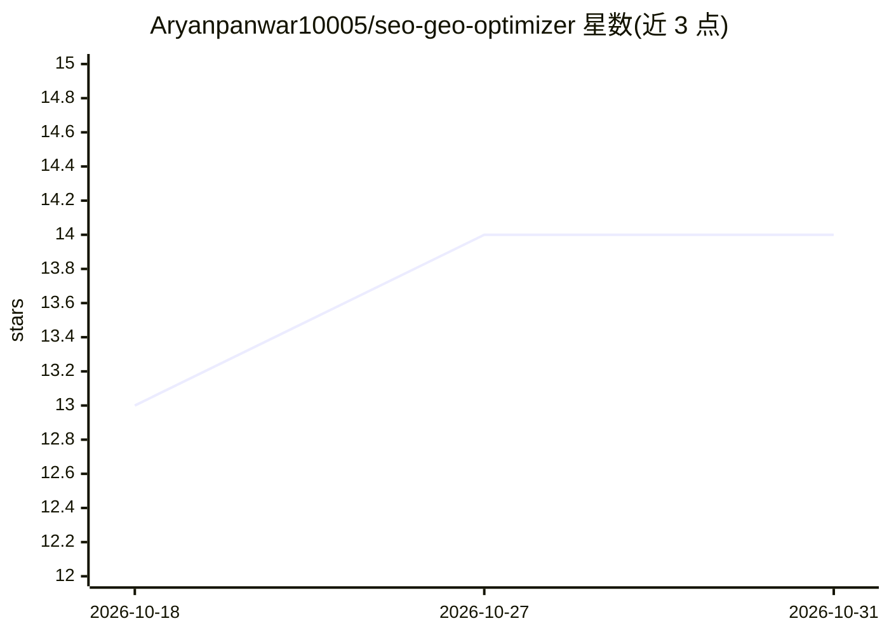

# Aryanpanwar10005/seo-geo-optimizer

⭐ 14 · JavaScript · MIT · 推送 2026-10-17 · [GitHub](https://github.com/Aryanpanwar10005/seo-geo-optimizer) · [官网](https://aryanpanwar.in/case-studies/seo-geo-optimizer) · 个人维护

**面向 AI 编程代理的 SEO/GEO 审计优化技能包**

以 npm 包分发的 agent skill：将一套结构化的技术 SEO 与 GEO（生成式引擎优化）工作流安装到 Claude Code、Cursor、GitHub Copilot、Windsurf 等编程代理的 skills 目录。运行后代理执行 14 阶段流程：32 题访谈、3–5 个竞品分析、执行计划审批后分五个层级逐级实施，覆盖结构化数据（JSON-LD）、Core Web Vitals、Google/Bing 差异与 AI 搜索可见性，每项改动须用户批准并引用官方文档。技能内容按阶段拆分在 references/ 文件中，代理按需读取；对不支持 skills 的工具可粘贴单文件版到系统提示词。

## 筛选速览

| 维度 | 判定 | 备注 |
|---|---|---|
| AI 角色 | `ai-ecosystem` | LLM/agent 周边工具 |
| 许可风险 | `permissive` | MIT |
| 部署形态 | `library` | 以包/库形式分发 |
| 模型依赖 | — | README 未给出锁定关系 |
| 硬件要求 | — | 无带数字的原话,不猜 |
| 安装摩擦 | `low` | 无编译、无系统依赖或容器化 |
| 成熟度 | — | 结构信号不足 |

## 能力要点

- 14 阶段工作流：访谈→竞品分析→执行计划→五层级实施→验证与监控
- 8 条铁律约束代理行为：计划先于执行、零自主变更、每项建议引用官方文档
- 安装器支持十余种编程代理工具的项目级/全局安装与卸载
- 内容按阶段拆分为 references/ 文件，代理进入对应阶段时才读取

## 适用场景

- 让我的 AI 编程代理对网站做结构化 SEO 与 GEO 审计
- 在 Claude Code/Cursor 等工具中按阶段推进 SEO 优化并逐项审批变更
- 提升网站在 AI Overviews、ChatGPT、Perplexity 等 AI 搜索中的可见性

## 场景标签

`提示工程` · 领域:Agent 开发

## 证据(README 行号)

> L3:  An agent skill that runs a structured SEO and GEO audit of your site.
> L12: Your AI coding agent (Claude Code, Codex, Cursor, GitHub Copilot, Windsurf, Antigravity and others) gets a step-by-
> L24: The installer copies the skill into `.agents/skills/seo-geo-optimizer/`, which most AI coding tools read, and into 

## 星数曲线

2026-10-18 13 → 2026-10-31 14（+1）

---
*卡片 v1 · prompt 1.4 · 生成 2026-10-31 · 置信度 high · 依据 README sha `0230deb0f521` · [字段定义](../../DATASET.md)*
